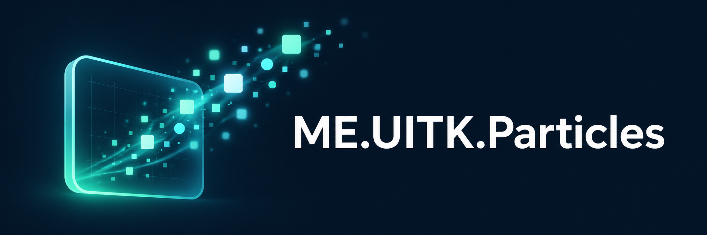
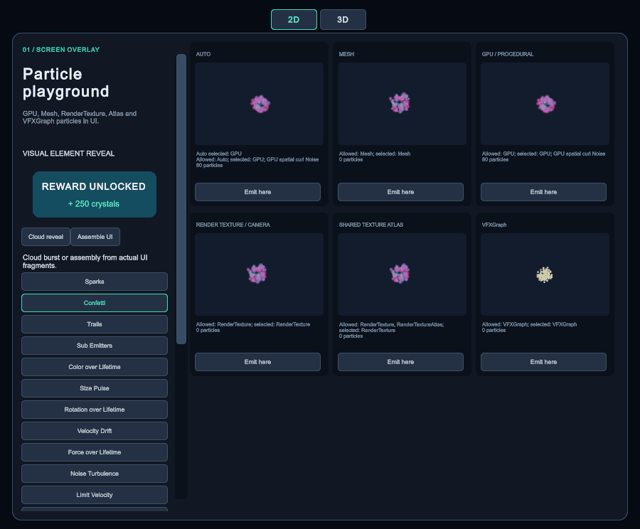
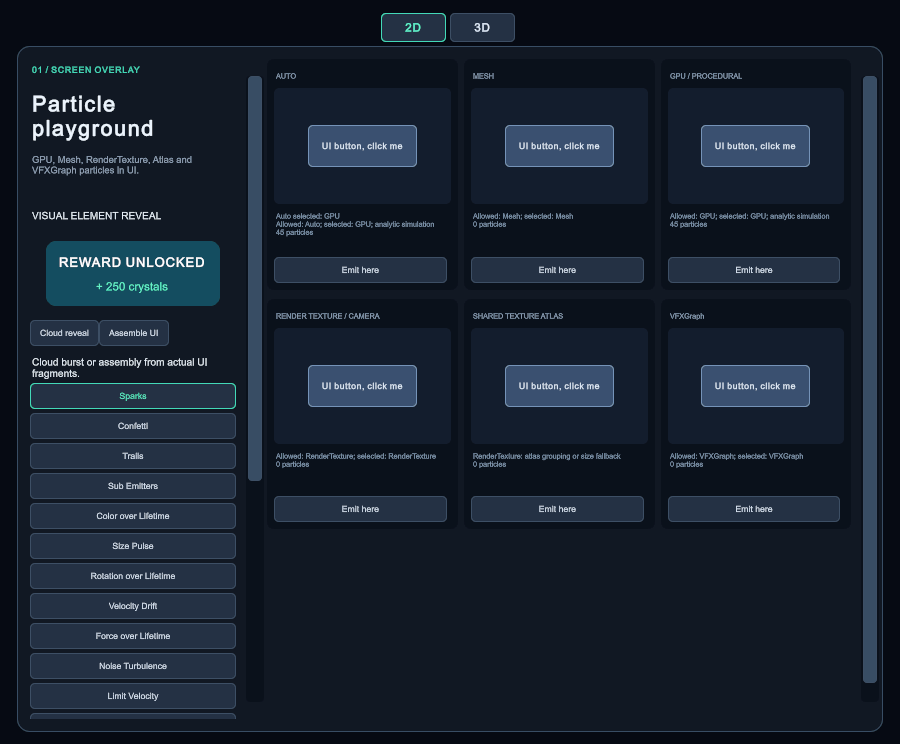
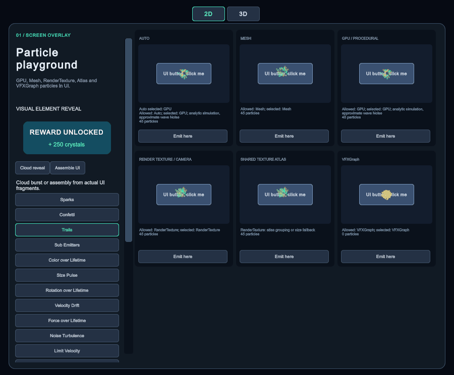

<div align="center">



# ME.UITK.Particles

[English](README.md) | **Русский**

**Ваши ParticleSystem-префабы внутри UI Toolkit.**

Нативная симуляция Unity | Mesh, RT, GPU и VFX Graph | Overlay и UI в мире

**Без managed-аллокаций в измеренных путях отрисовки после прогрева.**

[Область измерений и исключения](#производительность-и-аллокации)


[Быстрый старт](#быстрый-старт) | [API](#справочник-api) | [Рендеринг](#способы-рендеринга) | [Демо](#демонстрационная-сцена) | [Стресс-тест](#стресс-тест)



*Запись настоящего Game View Unity. Переключение с 2D overlay на 3D UI в мире.*

</div>

## UXML и USS

`ParticleElement` зарегистрирован в UI Builder под именем `meparticles`.
Для короткого `<meparticles />` задайте default namespace `ME.UITK.Particles`, как ниже.
Другой вариант: `xmlns:me="ME.UITK.Particles"` и `<me:meparticles />`.
Сохраните CSS ниже в `Effects.uss` рядом с UXML.

```xml
<ui:UXML xmlns:ui="UnityEngine.UIElements" xmlns="ME.UITK.Particles">
    <ui:Style src="Effects.uss" />
    <meparticles name="reward" class="reward-particles"
        prefab="project://database/Assets/ME.UITK.Particles/Demo/Generated/Confetti.prefab"
        render-mode="Auto" auto-play="true" pixels-per-unit="65"
        completion-time-enabled="true" completion-time-greater-than="2"
        stop-on-completion="true" />
</ui:UXML>
```

```css
.reward-particles {
    width: 300px;
    height: 220px;
    overflow: hidden;
    --meparticles-pixels-per-unit: 80;
    --meparticles-use-jobs: true;
}

.reward-particles.compact {
    --meparticles-pixels-per-unit: 42;
}
```

Следующие декларативные настройки доступны в UXML:

| Атрибут | Тип / значения | По-умолчанию |
| --- | --- |--------------|
| `prefab` | GameObject asset | null         |
| `render-mode` | `Auto`, `Mesh`, `RenderTexture`, `RenderTextureAtlas`, `GPU`, `VFXGraph` | `Auto`       |
| `auto-play` | bool | `true`       |
| `pixels-per-unit` | float > 0 | `65`         |
| `use-jobs` | bool | `true`       |
| `job-vertex-threshold` | uint | `4096`       |
| `gpu-bounds-center` | Vector3 | `0,0,0`      |
| `gpu-bounds-size` | Vector3, positive | `10,10,10`   |
| `completion-time-enabled` | bool | `false`      |
| `completion-time-greater-than` | float >= 0 | `0`          |
| `completion-count-enabled` | bool | `false`      |
| `completion-count-less-than` | uint >= 1 when enabled | `1`          |
| `completion-match` | `Any`, `All` | `Any`        |
| `completion-clock` | `Unscaled`, `Scaled` | `Unscaled`   |
| `stop-on-completion` | bool | `false`      |

Для скалярных атрибутов USS-имя совпадает с UXML-именем с префиксом `--meparticles-`.
Векторы в USS задаются по компонентам: `--meparticles-gpu-bounds-center-x`, `-y`, `-z`
и `--meparticles-gpu-bounds-size-x`, `-y`, `-z`. Числа без единиц, bool — `true` / `false`,
enum — имена из таблицы. Обычные USS-свойства управляют layout, opacity и clipping.
На элемент автоматически добавляется класс `meparticles`.

`prefab` задаётся только через UXML как ссылка на GameObject-ассет (в UI Builder можно
выбрать объект). USS не загружает префабы. Эта ссылка сохраняется в VisualTreeAsset,
поэтому Resources и UnityEditor в runtime не нужны. Модули ParticleSystem и VFX Graph
по-прежнему настраиваются на префабе; диагностические read-only свойства не являются атрибутами.

USS имеет приоритет над UXML; удаление правила или класса возвращает значение UXML.
Настройки применяются одним запланированным обновлением после подключения к панели,
а не во время каждого отдельного setter. `auto-play` запускает первоначальное воспроизведение;
переход `false` → `true` запускает его заново, `true` → `false` останавливает и очищает эффект.
Изменение масштаба или другого обычного стиля не перезапускает остановленный эффект.
Замена prefab или render-mode пересоздаёт backend и возобновляет игравший эффект при `auto-play=true`.
Условия завершения, как и в C# API, фиксируются при `Play()`; изменения действуют со следующего запуска.
Ошибочные значения выводятся в Console.

Для изменения декларативных значений из C# используйте свойства `uxmlPrefab`, `uxmlRenderMode`,
`uxmlPixelsPerUnit` и аналогичные `uxml*` свойства: USS продолжит иметь приоритет.
Обычный API `SetPrefab` / `Play` и свойства C# сохраняются для программно созданных элементов.
Не смешивайте эти способы настройки одного элемента: следующее применение USS восстановит его
декларативную конфигурацию.

Готовые файлы: [ParticleMarkup.uxml](Demo/ParticleMarkup.uxml), [ParticleMarkup.uss](Demo/ParticleMarkup.uss).
Проверка импорта, автозапуска, атрибутов, смены классов и Dispose:
**Tools > Checks > ME.UITK.Particles > Run Markup Checks**, отчёт `Logs/ParticleUI-Markup.txt`.

### Анимации USS

Обычные `transition-property`, `transition-duration`, `transition-delay` и
`transition-timing-function` UI Toolkit анимируют `opacity`, `scale`, `translate`, `rotate`
и другие поддерживаемые Unity свойства всего элемента, независимо от backend.
Для собственных параметров частиц предусмотрены дополнительные USS-переходы:

```css
.card-particles {
    opacity: 1;
    scale: 1 1;
    transition-property: opacity, scale, rotate;
    transition-duration: 450ms;
    transition-timing-function: ease-in-out;
    --meparticles-transition-duration: 450ms;
    --meparticles-transition-delay: 0s;
    --meparticles-transition-timing-function: ease-in-out;
}

.animated .card-particles {
    opacity: 0.65;
    scale: 1.1 1.1;
    rotate: 12deg;
    --meparticles-pixels-per-unit: 72;
}
```

`--meparticles-transition-duration` и `--meparticles-transition-delay` принимают секунды
(`0.45s`), миллисекунды (`450ms`) или число секунд без единиц. По умолчанию оба равны нулю;
значения должны быть конечными и неотрицательными. `--meparticles-transition-timing-function`
принимает `linear` (по умолчанию), `ease-in`, `ease-out`, `ease-in-out`. Эти функции используют
линейную, квадратичную входящую/исходящую и smoothstep-интерполяцию соответственно; они не
являются CSS cubic-bezier. Одна настройка перехода применяется к `pixels-per-unit` и всем
компонентам VFXGraph bounds. Bool, enum, пороги и настройки завершения меняются сразу.

Первое применение и замена prefab / render-mode устанавливают значения сразу. Последующие
изменения плавно идут от текущего значения, в том числе при развороте незавершённого перехода.
Нулевая duration отключает переход. Время всегда unscaled; анимация работает и для остановленного
эффекта, не создавая новый backend и не вызывая Play. При detach переход завершается целевым
значением и таймер останавливается; Dispose также останавливает таймер.
Нативный `transition-property` не обрабатывает `--meparticles-*`: для них используются
именно дополнительные настройки выше. CSS `@keyframes` и `animation-name` не реализованы.

[ParticleDemo.uxml](Demo/ParticleDemo.uxml) и [ParticleStressTest.uxml](Demo/ParticleStressTest.uxml)
содержат верстку демо. [ParticleClick.uxml](Demo/ParticleClick.uxml) и
[ParticleStressCell.uxml](Demo/ParticleStressCell.uxml) — шаблоны динамических эффектов.
Сцены и генераторы ссылаются на эти ассеты. В playground переключатель **Animate USS**
демонстрирует переходы при добавлении/снятии класса, hover карточки — стандартный `scale`.
Стресс-тест не включает анимацию во время измерений.

Если нужно менять UXML-настройки и сразу вызывать Play в том же кадре, вызовите
`ApplyUxmlSettings()` после изменения `uxml*` свойств. Обычный отложенный путь остаётся
предпочтительным для разметки и смены USS-классов.
**Run Markup Checks** проверяет также delay, интерполяцию bounds, разворот и Dispose.
**Run Demo Markup Checks** запускается из Edit Mode и проверяет обе сцены в Play Mode,
записывая `Logs/ParticleUI-DemoMarkup.txt`; после проверки возвращает редактор в Edit Mode.


## Возможности

Добавьте `ParticleElement` в визуальное дерево, назначьте префаб и вызовите `Play()`.
Unity выполняет исходную симуляцию частиц, а элемент показывает её результат внутри UI Toolkit.

- **Используйте готовые эффекты.** Модули ParticleSystem остаются в нативной симуляции Unity, включая дочерние системы и sub-emitters.
- **Выбирайте из четырёх способов отрисовки.** Auto выбирает Mesh, RT или GPU для совместимых эффектов ParticleSystem. Для префабов VFX Graph включайте VFXGraph вручную.
- **Размещайте частицы среди элементов UI.** Рисуйте их позади кнопки, поверх её текста или внутри контейнера с маской. Частицы пропускают события указателя.
- **Сохраняйте эффект в кадре.** RT-путь оценивает границы системы перед запуском и расширяет их во время работы, сохраняя масштаб частиц.
- **Управляйте ресурсами через визуальное дерево.** Detach освобождает ресурсы, attach создаёт эффект заново. `Dispose()` также сбрасывает префаб и намерение продолжать воспроизведение.

> Это прототип адаптера, а не преобразование в отдельный движок частиц. Нативная симуляция не гарантирует идентичную отрисовку для любых шейдеров и сочетаний модулей. См. [ограничения](#ограничения).

## Быстрый старт

### Установка и запуск демо

1. Скопируйте или клонируйте репозиторий в `Assets/ME.UITK.Particles` проекта **Unity 6000.6.0f1**, настроенного на **URP 17.6.0**. Установите **Burst 2.0.0**, **Input System 1.20.0** и **Unity UI (uGUI) 2.6.0** через Package Manager. В Player Settings включите Input System (Active Input Handling: Input System Package или Both).
2. Откройте [`ParticlePlayground.unity`](Demo/ParticlePlayground.unity).
3. Включите Play Mode и выберите пресет. Попробуйте **Clipping**, **Behind UI** и **Above UI**.

Репозиторий содержит папку ассетов: runtime-код, инструменты редактора и демо. Разместите её в `Assets/ME.UITK.Particles`: этот путь используют генераторы демо. Это не UPM-пакет. Другие версии Unity и render pipeline не проверялись.

### Подключение к своему проекту

Код разделён на сборки `ME.UITK.Particles` (runtime), `ME.UITK.Particles.Demo` и `ME.UITK.Particles.Editor` (только Editor). Если ваши скрипты используют asmdef, добавьте ссылку на `ME.UITK.Particles`. Runtime-сборка ссылается на Burst и Collections и не зависит от демо или инструментов редактора.

Скопируйте [`Runtime`](Runtime), включая шейдеры, каталог `Resources` и `.meta`-файлы, в совместимый Unity-проект. Для компиляции job требуется Burst.
Используйте настроенный `UIDocument` и зарезервируйте **слой 31** для адаптера. Исключите его из камер сцены: этот слой рендерят служебные камеры адаптера.

```csharp
using ME.UITK.Particles;
using UnityEngine.UIElements;

// document: ваш UIDocument; effectPrefab: GameObject с ParticleSystem.
var particles = new ParticleElement { pixelsPerUnit = 60f, };
particles.style.width = 300;
particles.style.height = 220;

// Настройте элемент перед присоединением, чтобы создать нужный эффект.
particles.SetPrefab(effectPrefab, ParticleRenderMode.Auto);
document.rootVisualElement.Add(particles);
particles.Play();
```

Начало координат префаба соответствует центру `contentRect` элемента. `pixelsPerUnit` задаёт масштаб в единицах UI: чем больше значение, тем крупнее эффект.
`Auto` выбирает Mesh только для совместимых эффектов с шейдером материала `ParticleUI/Alpha` из проекта.

<details>
<summary><strong>Полный пример MonoBehaviour</strong></summary>

Добавьте компонент на объект с настроенным `UIDocument`, назначьте префаб частиц и включите Play Mode.

```csharp
using ME.UITK.Particles;
using UnityEngine;
using UnityEngine.UIElements;

[RequireComponent(typeof(UIDocument))]
public sealed class ParticlePanel : MonoBehaviour {

    [SerializeField] private GameObject effectPrefab;
    private ParticleElement particles;
    private VisualElement container;

    private void OnEnable() {

        this.container = new VisualElement();
        this.particles = new ParticleElement { pixelsPerUnit = 60f, };
        this.particles.style.width = 300;
        this.particles.style.height = 220;
        this.particles.SetPrefab(this.effectPrefab);
        this.container.Add(this.particles);
        this.container.Add(new Button(this.particles.Play) { text = "Celebrate", });
        this.GetComponent<UIDocument>().rootVisualElement.Add(this.container);

    }

    private void OnDisable() {

        this.particles?.Dispose();
        this.container?.RemoveFromHierarchy();
        this.particles = null;
        this.container = null;

    }

}
```

</details>

## Завершение проигрывания

Подпишитесь до вызова `Play()`. С настройками по умолчанию `ParticleCompletedEvent` отправляется после завершения всех нативных систем, включая дочерние и sub-emitters. Для завершения looping-эффекта во время эмиссии задайте порог.

```csharp
effect.completionSettings = new ParticleCompletionSettings {
    timeEnabled = true,
    timeGreaterThan = 2f,
    countEnabled = true,
    countLessThan = 5,
    match = ParticleCompletionMatch.All,
    clock = ParticleCompletionClock.Unscaled,
    stopOnCompletion = true,
};
effect.RegisterCallback<ParticleCompletedEvent>(OnParticlesCompleted);
effect.Play();

void OnParticlesCompleted(ParticleCompletedEvent evt) {
    Debug.Log("Particle playback completed");
}

// Когда подписчик больше не нужен:
// effect.UnregisterCallback<ParticleCompletedEvent>(OnParticlesCompleted);
```

- `All` требует выполнения всех включённых условий, `Any` — хотя бы одного. Включите одно условие, если нужно проверять только время или только количество частиц.
- Сравнения строгие: прошедшее время **> X**, суммарное число живых частиц **< Y**. Время должно быть конечным и неотрицательным, Y — не меньше 1. Для проверки нулевого количества частиц задайте Y = 1.
- Начальный ноль до эмиссии или окончания start delay игнорируется, пока не будут замечены частицы либо все системы не завершатся естественным образом. Последующие промежутки между bursts могут удовлетворить условию по количеству. Чтобы дождаться всей будущей эмиссии, используйте естественное завершение без порогов.
- Отсчёт начинается, когда присоединённый экземпляр действительно запускается. По умолчанию используется unscaled time; `Scaled` следует игровому времени Unity. Это прошедшее реальное или игровое время, независимо от скорости симуляции отдельных систем.
- Настройки фиксируются при каждом `Play()`. Обработчик вызывается на основном потоке один раз за проигрывание, при scheduled-обновлении элемента. `hasCompletedPlayback` показывает результат. Из обработчика можно безопасно перезапустить или освободить элемент.
- По умолчанию `stopOnCompletion = false`: уведомление не прерывает отрисовку и эмиссию. Значение `true` останавливает и очищает эффект перед отправкой события.
- Ручной `Stop()`, `SetPrefab()`, detach и `Dispose()` отменяют ожидающее уведомление. Повторный attach играющего элемента запускает новое проигрывание. Подписки сохраняются до `UnregisterCallback<ParticleCompletedEvent>()`. Событие из пула поддерживает trickle-down и bubbling: `evt.target` — элемент частиц, `evt.currentTarget` — текущий слушатель. Экземпляр события нельзя хранить после обработчика. Первое расширение пула может выделять память.

В Play Mode демо запустите **Tools → Checks → ME.UITK.Particles → Run Completion Checks** для проверки границ порогов, Any/All, дочерних систем, перезапуска, отмены и доставки события планировщиком.

## Частицы позади и поверх UI



*Запись переключается с Behind UI на Above UI. Оба способа рендеринга следуют порядку визуального дерева.*

Разместите элемент частиц абсолютно, чтобы он покрывал ту же область, что и кнопка. Для `PlaceBehind` / `PlaceInFront` у них должен быть общий родитель.

```csharp
var root = document.rootVisualElement;
var container = new VisualElement();
container.style.width = 300;
container.style.height = 160;
container.style.overflow = Overflow.Visible;
root.Add(container);

var button = new Button { text = "Claim reward", };
button.style.alignSelf = Align.Center;
button.style.marginTop = 60;
container.Add(button);

var particles = new ParticleElement { pixelsPerUnit = 60f, };
particles.style.position = Position.Absolute;
particles.style.left = particles.style.right = 0;
particles.style.top = particles.style.bottom = 0;
particles.SetPrefab(effectPrefab);
container.Add(particles);

particles.PlaceBehind(button); // Непрозрачная кнопка закрывает частицы.
// particles.PlaceInFront(button); // Частицы перекрывают кнопку и её текст.
button.clicked += particles.Play;
```

`ParticleElement` и его дочерний элемент с текстурой используют `PickingMode.Ignore`, поэтому кнопка продолжает получать клики.
Для маски задайте `container.style.overflow = Overflow.Hidden`. Эффект может обрезать любой предок с clipping, даже если сам элемент частиц разрешает выход за свои границы.

## Способы рендеринга

`ParticleRenderMode` — маска `[Flags]`. `Auto` включает GPU, Mesh, RenderTexture и RenderTextureAtlas. Можно передать любое непустое подмножество: исключённые режимы не используются даже как fallback. VFXGraph остаётся отдельным явным режимом и не объединяется с режимами ParticleSystem.

```csharp
// Все четыре пути ParticleSystem:
particles.SetPrefab(prefab, ParticleRenderMode.Auto);
// Всё, кроме Atlas:
particles.SetPrefab(prefab, ParticleRenderMode.Auto & ~ParticleRenderMode.RenderTextureAtlas);
// Только прямая отрисовка:
particles.SetPrefab(prefab, ParticleRenderMode.GPU | ParticleRenderMode.Mesh);
// Atlas с разрешённым fallback на отдельный RT:
particles.SetPrefab(prefab, ParticleRenderMode.RenderTexture | ParticleRenderMode.RenderTextureAtlas);
```

В UXML имена перечисляются через запятую: `render-mode="GPU, Mesh"`. Один флаг принудительно выбирает этот режим. Пустые маски, неизвестные биты и сочетания с VFXGraph отклоняются. Если ни один разрешённый путь не поддерживает префаб, `SetPrefab` выбрасывает исключение, сохраняя текущий эффект. Без RT сравнение Mesh/RT не запускается. При разрешённом только Atlas атлас используется даже для одного эффекта; если плитка превышает ограничения устройства или размера, отрисовка приостанавливается (`activeMode == None`) до восстановления подходящего размера, без создания запрещённого RT.

Названия режимов изменены: `Shader` -> `GPU` (значение `4`), прежний `GPU` -> `VFXGraph` (значение `16`). Числовые значения в сценах и префабах сохранены. Во внешнем C# и UXML обновите имена: прежнее имя `GPU` теперь выбирает путь ParticleSystem. `gpuBounds` сохранил прежнее имя.

Числовые значения enum изменились: прежний Auto `0` теперь `15`, VFXGraph `3` теперь `16`, Atlas `5` теперь `8`; Mesh `1`, RT `2` и GPU `4` не изменились. UXML текущего проекта хранит имена и не требует изменения исходников. Внешние сериализованные числовые данные нужно однократно мигрировать по этому соответствию до интерпретации как масок: прежние `3` и `5` теперь являются допустимыми сочетаниями и автоматически неотличимы от новых масок.

`RenderTextureAtlas` — дополнительный режим: до четырёх совместимых эффектов разделяют одну камеру, две текстуры и один проход преобразования альфы. `Auto` сохраняет приоритет GPU, сравнивает Mesh/RT для совместимых с Mesh эффектов и объединяет подходящих кандидатов RenderTexture, включая RT, выбранный по результатам замера, при наличии четырёх играющих эффектов с одинаковыми размерами и разрешением плитки. Группа сохраняется до двух эффектов; один оставшийся активный эффект возвращается на RT без перезапуска симуляции.

В демо есть отдельная карточка **SHARED TEXTURE ATLAS** рядом с RT. В стресс-тесте доступны **RenderTextureAtlas** и быстрые нагрузки на 4 или 16 элементов с 10 000 частиц суммарно. Фактический путь показывает `activeMode`. **Run Atlas Checks** проверяет пиксели итогового UI, изоляцию и ориентацию плиток, переходы Auto, остановку, detach/attach и fallback при слишком большой плитке.

Atlas поддерживает один локальный ParticleSystem на prefab: billboard-частицы с ориентацией View, материалом `ParticleUI/Alpha` и отключённой сортировкой. Мировые trails, гравитация, внешние взаимодействия и shape renderers, дополнительные компоненты и непроверенные шейдеры используют RT. Границы оцениваются заранее и проверяются перед рендером; растущие эффекты перегруппировываются. Плитки больше 1024 пикселей по любой оси или 128 мировых единиц переходят на RT, только если RT разрешён маской; иначе отрисовка приостанавливается. Страницам атласа нужна поддержка текстур 2048. Остановленные элементы сохраняют плитки, но не рисуются; пустые страницы освобождаются при Dispose.

Атлас уменьшает расходы на камеры и преобразование альфы, но не на симуляцию и draw calls самих частиц. Запас вокруг эффектов и неполные страницы могут увеличить память текстур и стоимость заполнения. Проверяйте группы эффектов на целевом устройстве; для одного эффекта ускорение не ожидается.

```csharp
particles.SetPrefab(effectPrefab, ParticleRenderMode.RenderTextureAtlas);
particles.Play();
```

Auto сначала проверяет GPU, затем сравнивает **Mesh / RenderTexture** для совместимых с Mesh эффектов; для несовместимых использует **RenderTexture / RenderTextureAtlas**. Если RT победил в замере, эффект тоже может войти в Atlas; при близком времени кадра предпочтение остаётся у Mesh. Для VFX Graph требуется явный `ParticleRenderMode.VFXGraph`. Команды **Run Render Mode Checks** и **Run Atlas Checks** проверяют выбор режимов и объединение эффектов.

Есть **пять способов отрисовки: Mesh, RenderTexture (RT), RenderTextureAtlas, GPU и VFXGraph / VFX Graph**. `Auto` выбирает подходящий путь; VFX Graph по-прежнему включается явно.

| Режим | Поведение |
| :--- | :--- |
| `Auto` | Выбирает совместимый GPU, иначе сравнивает Mesh/RT и объединяет подходящие RT-эффекты в Atlas. VFX Graph автоматически не выбирается. |
| `Mesh` | Отрисовка геометрии ParticleSystem через UI Toolkit. Несовместимый префаб отклоняется с сохранением текущего эффекта; автоматического переключения нет. |
| `RenderTexture` (RT) | Нативный рендер ParticleSystem камерой в прозрачную текстуру. |
| `RenderTextureAtlas` | Общая камера и текстуры для совместимых нативных эффектов, с fallback на RT только при наличии его флага в маске. |
| `GPU` | Шейдерный путь для совместимых эффектов ParticleSystem с поддерживаемым набором модулей. |
| `VFXGraph` / VFX Graph | Включается вручную для префаба с `VisualEffect` и назначенным VFX Graph. |

**Mesh** использует `ParticleSystemRenderer.BakeMesh` и отрисовку мешей UI Toolkit. Требуются billboard-частицы в локальном пространстве, шейдер `ParticleUI/Alpha` и неизменённые UV scale/offset материала. Шлейфы запекаются отдельно через `BakeTrailsMesh` со своим материалом `ParticleUI/Alpha` (также без UV scale/offset). Texture Sheet Animation в режимах Grid и Sprites использует запечённые UV. Спрайты должны быть Full Rect без tight packing и использовать общую текстуру; она имеет приоритет над текстурой материала. Particle lights и custom vertex data остаются несовместимыми с Mesh.

**Run Texture Sheet Checks** проверяет цвета четырёх кадров Grid/Sprites в итоговом UI для Mesh (с Jobs и без), GPU и RenderTexture. Отчёт: `Logs/ParticleUI-TextureSheet.txt`. Значение `TextureSheetAnimationEnabled` теперь означает некорректный список спрайтов.

**RenderTexture** рендерит нативную систему с её материалами, преобразует alpha для композиции с UI и показывает результат в расширенном дочернем элементе. Пресет Trails также поддерживает прямую отрисовку в карточке Mesh.




### Процедурный GPU из ParticleSystem-префаба

`SetPrefab(prefab)` сначала проверяет GPU. Источник всех параметров — существующий ParticleSystem на корне префаба. Backend читает настройки, создаёт статический меш начальных данных и таблицу кривых; экземпляр ParticleSystem не создаётся и нативная симуляция не запускается. Положение, вращение, размер и цвет рассчитываются в vertex shader по времени. Камера и прозрачная RenderTexture остаются для композиции с UI, clipping и world-space панелей.

Поддерживается один активный корневой ParticleSystem с локальной симуляцией и единичным масштабом: один или несколько гарантированных burst в заданные моменты внутри Duration, без loop, prewarm и start delay, суммарно до 16 000 частиц в пределах maxParticles. Стартовые lifetime, speed, size и rotation — Constant или Two Constants; 3D Start Size поддерживает отдельные X/Y для billboard и сохраняет Z в API частиц; стартовый цвет — Color или Two Colors. Shape — выключен, полный Circle без дополнительных преобразований либо объём Box с position, rotation и scale. Box Shell/Edge и рандомизация направления пока не поддерживаются. Поддерживаются постоянная 3D-гравитация, одна кривая Size over Lifetime и один градиент Color over Lifetime. Используются simulationSpeed, useUnscaledTime, текстура и tint материала ParticleUI/Alpha. Billboard должен быть View-aligned без сортировки, pivot и flip.

Расписание burst использует постоянные целые количества, вероятность 1 и один цикл на запись. Шаг симуляции разделяется по моментам рождения, поэтому большой Simulate сохраняет правильный возраст каждой волны. Pause замораживает расписание, StopEmitting отменяет будущие волны, Play начинает его заново. Снимок состояния сохраняет позицию в очереди. Continuous emission, повторяющиеся циклы и случайные количества burst пока не поддерживаются. Демо Box Rain и Emission Waves работают в GPU без изменения префабов.

Модули движения в GPU:

| Модуль | Поддерживаемые настройки |
| --- | --- |
| Rotation over Lifetime | Вращение по Z, Separate Axes выключен. |
| Velocity over Lifetime | Линейные X/Y/Z в Local space, Orbital/Radial = 0, Speed Modifier = 1. |
| Force over Lifetime | X/Y/Z в Local space, Randomize выключен. |
| Noise | Приближённая GPU-турбулентность позиции: общая strength либо Separate Axes, frequency, damping, постоянные Scroll Speed и Position Amount, 1–4 октавы, multiplier/scale и выборки поля с учётом quality. Remap, Rotation Amount и Size Amount не поддерживаются. |

Rotation, velocity, force и strength шума принимают Constant, Two Constants, Curve и Two Curves. Скорости и их интегралы используют 256 отсчётов по нормализованному времени жизни. Noise без Trails и родительских Sub Emitters использует общее пространственное curl-поле в compute shader. Frequency задаёт пространственную детализацию, Scroll Speed перемещает поле, seed системы выбирает рисунок. Соседние частицы движутся согласованно; их random управляет strength, а не независимой фазой. Noise смещает позицию, не накапливаясь в базовой velocity. Это приближение, а не точное воспроизведение траекторий Unity. Для систем с Trails или родительскими Sub Emitters сохраняется аналитический шум из волн. Нативная симуляция ParticleSystem не используется; GetParticles читает GPU-состояние пространственного Noise. Пауза, повторный запуск, Emit и SetParticles сохраняют движение модулей.


Дополнительные модули GPU используют GPU-аналоги без нативной симуляции Shuriken:

| Модуль | Поддерживаемые настройки |
| --- | --- |
| Color / Size by Speed | Диапазоны скорости, градиенты/кривые и случайные min/max; размер поддерживает отдельные оси X/Y. |
| Rotation by Speed | Кривые вращения по Z и диапазон скорости. Аналитический путь использует восемь отсчётов на интервал; GPU-динамика интегрирует вращение по шагам. |
| Texture Sheet Animation | Grid до 256 ячеек по каждой оси, UV0, Whole Sheet / Single Row, Custom/Random row, Lifetime/Speed/FPS, cycles и start frame. Sprites поддерживает упорядоченный список Full Rect кадров на общей текстуре, включая поворот и отражение UV атласа. Tight packing, отсутствующие спрайты и разные текстуры отклоняются. MeshIndex не поддерживается для Single Row. |
| Inherit Velocity | Initial и Current со снимком Main Custom emitter velocity. Отслеживание Transform/Rigidbody не поддерживается, в том числе для сабэмиттеров. |
| Lifetime by Emitter Speed | Кривая и диапазон скорости при рождении, по Main Custom emitter velocity. |
| Limit Velocity over Lifetime | Local, постоянные скалярные или XYZ-лимиты, dampen, постоянный drag и его множители по размеру/скорости. |
| Collision | До восьми плоскостей, постоянные bounce/dampen/lifetime loss, radius scale, kill speeds. Без World, сообщений и силы на коллайдер. |
| Triggers | До восьми SphereCollider, объединение объёмов, Kill/Ignore для Inside/Outside/Enter/Exit. Без Callback. |
| External Forces | Явный List до восьми сферических полей направленного ветра, постоянные XYZ и multiplier. Без gravity/drag/vortex/vector texture самого поля. |
| Lights | Свечение billboard на GPU из шаблона Point Light без теней: кривые range/intensity, color, ratio, maxLights и опции размера/цвета/альфы частицы. Не освещает сцену и не создаёт Unity Light. |
| Custom Data | `GetCustomParticleData(List<Vector4>, ParticleSystemCustomData, systemIndex)` возвращает Vector/Color для живых частиц. Произвольные vertex streams материала и запись Custom Data не поддерживаются. |

Limit Velocity, Collision, Triggers и External Forces используют compute buffer и текстуру состояния GPU. Нужны compute shaders и запись в RGBAFloat. Интегратор делает шаги около 1/60 секунды, максимум 256 на вызов; большой шаг или быстрая частица могут пропустить тонкий объём триггера. Это приближение, а не Unity Physics. Геометрия и силы фиксируются при SetPrefab, без отслеживания объектов сцены. Эти модули пока нельзя сочетать с Trails или родительским Sub Emitters в одной системе; диагностика называет конкретное сочетание. Аналитический родитель может порождать дочерние частицы с GPU-динамикой.

Счётчики GPU-динамики читаются асинхронно и могут отставать на кадр или больше. GetParticles, SetParticles, Emit и чтение Custom Data при необходимости синхронизируют GPU и могут вызвать задержку; обычная симуляция остаётся на GPU. Аналитический путь считает частицы по lifetime без readback. Свечение выбирает первые maxLights слотов частиц, затем применяет ratio, поэтому видимых источников может быть меньше, чем при нативном распределении Unity.

**Run Extended GPU Checks** в Play Mode проверяет пиксели цвета/размера, кадры атласа, скорость эмиттера, Custom Data, GPU limit/drag, отскок от плоскости, уничтожение триггером, ветер, сохранение движения после чтения/записи и свечение без нативных объектов. Отчёт: `Logs/ParticleUI-GPUExtended.txt`.

Неподдерживаемые настройки модулей, иерархии систем, скрипты, дополнительные рендереры, другие материалы и неподдерживаемое устройство вызывают fallback Auto на Mesh/RenderTexture. Явный `ParticleRenderMode.GPU` отклоняет несовместимый префаб до замены текущего эффекта. `ParticleElement.GpuCompatibility(prefab)` возвращает `null` при совместимости или причину отказа; в Editor/DEBUG причина также добавляется в `compatibilityInfo`.

Кривые и градиенты аппроксимируются таблицей из 256 отсчётов. Распределение случайных значений сохраняет диапазоны настроек, но не повторяет последовательность RNG Unity. Seeds выбираются при создании backend; Play повторяет те же частицы. Изменения префаба после создания применяются повторным SetPrefab. Это ограниченная GPU-реализация, а не полная совместимость с Shuriken. `bakedVertexCount` равен 0; `particleCount` использует lifetime для аналитического движения и запаздывающий GPU readback для динамики. Естественное завершение и Stop используют обычный API элемента.

**Tools → Checks → ME.UITK.Particles → Run GPU Checks** в Play Mode проверяет Auto, отсутствие созданного ParticleSystem, видимые пиксели, завершение, повторный запуск, Stop, detach/attach и fallback. Отчёт: `Logs/ParticleUI-GPU.txt`. **Run GPU Module Checks** проверяет интегралы движения, диапазоны, SetParticles, Noise и диагностику; отчёт: `Logs/ParticleUI-GPUModules.txt`.

GPU также поддерживает **Trails** в режиме Per Particle: локальное пространство, Stretch UV, ratio, постоянный lifetime, Die With Particles, Size Affects Width, Inherit Particle Color, кривую ширины и градиенты цвета. Нужен trail material с `ParticleUI/Alpha`. Ribbon, World Space, lighting data, Size Affects Lifetime и случайные/двойные кривые трейла пока отклоняются. Полоса строится в GPU по аналитической траектории, с 2–32 сегментами по Min Vertex Distance и оценке пути. Это приближение нативного размещения точек. SetParticles восстанавливает живой трейл по изменённой траектории, поэтому правка может сдвинуть его историю. Хвосты умерших частиц сохраняются при Emit до истечения lifetime, до 16 000 сохранённых полос на систему. Stop и повторный Play очищают историю. Естественное завершение ждёт хвосты, даже когда particleCount уже равен нулю.

Для **Sub Emitters** доступны Birth и Death, вероятность события, Inherit Color/Size/Rotation. Допускаются до восьми активных непосредственных дочерних систем с нулевыми локальными position/rotation, единичным scale и теми же simulationSpeed/useUnscaledTime, что у корня. Каждая дочерняя система должна быть совместима с GPU, включая одиночный burst; её Trails и модули движения также работают. Частицы рождаются только по событию, в позиции родителя и в точный момент события, в том числе при большом шаге времени. Collision, Trigger, Manual, вложенные сабэмиттеры и наследование Lifetime/Duration пока отклоняются. CPU обрабатывает события, а движение и трейлы рассчитывает шейдер без нативной симуляции ParticleSystem. API частиц и Emit учитывают дочерний systemIndex в порядке иерархии. Общий particleCount суммирует системы, завершение ждёт дочерние частицы. SetParticles пересчитывает будущие Death-события, но не порождает Birth и Death для явно удалённых частиц.

Демо Trails и Sub Emitters работают в GPU-карточке и Auto. **Run GPU Hierarchy Checks** в Play Mode проверяет события, наследование, API дочерних частиц, паузу, Emit, видимые хвосты после смерти и завершение. Отчёт: `Logs/ParticleUI-GPUHierarchy.txt`.

### Границы без обрезки по viewport

Перед проигрыванием адаптер оценивает границы нативных рендереров всей иерархии, включая дочерние системы и trails, добавляя **запас 10%** и минимальный отступ. Затем перед рендером камеры проверяет текущие границы и при необходимости расширяет область захвата.

Текстура позиционируется относительно эмиттера: асимметричные границы не смещают эффект. Разрешение ограничено **1024 пикселями на сторону**. Большие границы снижают детализацию, но не обрезают эффект и не меняют его размер в UI.

Предварительная симуляция ограничена **15 секундами / 450 шагами**. Более долгие и случайные эффекты используют расширение границ во время работы. Это оценка по симуляции, а не математическая гарантия для произвольного смещения вершин шейдером.

## Справочник API

Счётчики и пороги (`particleCount`, `bakedVertexCount`, `jobVertexThreshold`, `countLessThan`) используют `uint`. Метод `Configure` стресс-теста также принимает количества типа `uint`. Перед преобразованием signed-переменных проверяйте диапазон. Размеры буферов Unity и индексы коллекций остаются `int`.

Пространство имён: **`ME.UITK.Particles`**

| Член API | Назначение |
| :--- | :--- |
| `ParticleElement()` | Создаёт элемент; перед обращением к симуляции добавьте его на панель. |
| `SetPrefab(GameObject value, ParticleRenderMode mode = ParticleRenderMode.Auto)` | Заменяет префаб, освобождает backend и сбрасывает намерение проигрывания. Явные Mesh/GPU проверяют совместимость, VFXGraph требует VFX-префаб. |
| `Play() / Stop()` | Перезапуск с начала / немедленная остановка с очисткой. |
| `Pause() / Resume() / StopEmitting()` | Заморозить симуляцию и время завершения / продолжить / прекратить эмиссию, сохранив живые частицы. |
| `Emit(uint count, int systemIndex = 0)` | Добавить burst с настроенными начальными параметрами. |
| `EmitIn(VisualElement target, uint count, int systemIndex = 0)` | Добавить burst по текущему прямоугольнику другого элемента. |
| `SetPosition(Vector2 offset) / positionOffset` | Задать/прочитать смещение в UI от contentRect.center; по умолчанию ноль. |
| `SetTint(Color color) / tint` | Задать/прочитать множитель итогового цвета; по умолчанию белый, конечные каналы в [0, 1]. |
| `SetVisualScale(float value) / visualScale` | Задать/прочитать визуальный множитель pixelsPerUnit; по умолчанию 1, конечный и положительный. |
| `SetSystemScale(Vector3 value) / systemScale` | Задать/прочитать множитель масштаба корня префаба; по умолчанию Vector3.one, конечные положительные компоненты. |
| `simulationSpeed` | Множитель скорости, чтение/запись, по умолчанию 1, конечный и неотрицательный. Ноль не замораживает время завершения. |
| `pixelsPerUnit` | Единицы UI на единицу симуляции, чтение/запись, по умолчанию 65f; используйте конечное положительное значение. |
| `GetParticles(ParticleSystem.Particle[] particles, int size = -1, int offset = 0, int systemIndex = 0)` | Возвращает число частиц, скопированных в переиспользуемый буфер. |
| `SetParticles(ParticleSystem.Particle[] particles, int size = -1, int offset = 0, int systemIndex = 0)` | Записывает частицы из буфера без перезапуска. |
| `GetParticleCount(int systemIndex = 0)` | Возвращает uint, число живых частиц одной системы. |
| `SimulationToLocal(Vector3 position, int systemIndex = 0) / LocalToSimulation(Vector3 position, int systemIndex = 0)` | Преобразуют координаты симуляции в локальные координаты UI элемента и обратно; возвращают Vector3. |
| `supportsParticleAccess / particleSystemCount` | Доступность операций с частицами и число систем, только чтение: нативная иерархия / GPU 1 / VFXGraph 0. |
| `capabilities` | Флаги ParticleCapabilities, только чтение; None до инициализации. |
| `isAlive / isPlaying / isPaused` | Только чтение: живые частицы или ожидаемая эмиссия / активный запуск без паузы / явная пауза. |
| `completionSettings / hasCompletedPlayback` | Условия завершения, чтение/запись / результат текущего запуска, только чтение. |
| `RegisterCallback<ParticleCompletedEvent>() / UnregisterCallback<ParticleCompletedEvent>()` | Унаследованный API UITK для подписки на событие завершения и отписки. |
| `activeMode / isAutoSelecting` | Только чтение: выбранный режим рендеринга / продолжает ли Auto выбор режима. |
| `compatibilityInfo` | Диагностическое пояснение в Editor или DEBUG, иначе заглушка; только чтение. |
| `hasInstance` | Создан ли backend, включая GPU и VFXGraph; только чтение. |
| `particleCount / bakedVertexCount / renderBounds` | Только чтение: суммарное число частиц / число запечённых вершин / границы рендеринга backend. Счётчики VFXGraph асинхронны. |
| `useJobs / jobVertexThreshold` | Настройки jobs для Mesh, чтение/запись; по умолчанию true / 4096u. |
| `gpuBounds` | Bounds захвата VFXGraph, чтение/запись, центр нулевой и размер (10,10,10); конечные значения и положительный размер. |
| `ParticleElement.MeshCompatibility(GameObject source)` | Возвращает первую причину MeshCompatibilityResult. |
| `ParticleElement.GpuCompatibility(GameObject source)` | Возвращает null при совместимости, иначе строку с причиной. |
| `ApplyUxmlSettings()` | Немедленно применяет ожидающие настройки uxml* с текущими переопределениями USS. |
| `Dispose()` | Освобождает ресурсы и сбрасывает префаб/намерение проигрывания; удаление из иерархии вызывается отдельно. |

```csharp
// Замените текущий эффект и явно выберите RenderTexture.
particles.SetPrefab(trailsPrefab, ParticleRenderMode.RenderTexture);
particles.Play();

Debug.Log($"{particles.activeMode}: {particles.compatibilityInfo}");
Debug.Log($"Live particles: {particles.particleCount}");

particles.Stop();
particles.Dispose();
particles.RemoveFromHierarchy();
```

### Жизненный цикл, отображение и диагностика

Ниже приведены независимые примеры использования. `root` — VisualElement на подключённой панели, `effectPrefab` — префаб ParticleSystem, `vfxPrefab` — префаб VFX Graph. Подключите три пространства имён из примера. Диагностику читайте после инициализации; счётчики и границы обновляются при отрисовке.

```csharp
using ME.UITK.Particles;
using UnityEngine;
using UnityEngine.UIElements;

var particles = new ParticleElement {
    pixelsPerUnit = 65f,
    useJobs = true,
    jobVertexThreshold = 4096u,
    simulationSpeed = 1f,
};
particles.style.width = 400f;
particles.style.height = 240f;
particles.SetPrefab(effectPrefab, ParticleRenderMode.Auto);
root.Add(particles);
particles.Play();

particles.Pause();
Debug.Log($"Paused: {particles.isPaused}, alive: {particles.isAlive}");
particles.Resume();
particles.StopEmitting();
Debug.Log($"Playing: {particles.isPlaying}, completed: {particles.hasCompletedPlayback}");

particles.SetPosition(new Vector2(10f, -5f));
particles.SetTint(new Color(1f, .8f, .5f, .75f));
particles.SetVisualScale(1.5f);
particles.SetSystemScale(new Vector3(2f, 1f, 1f));
Debug.Log($"Offset: {particles.positionOffset}, tint: {particles.tint}");
Debug.Log($"Scales: {particles.visualScale}, {particles.systemScale}");

Debug.Log($"Backend: {particles.hasInstance}, mode: {particles.activeMode}");
Debug.Log($"Selecting: {particles.isAutoSelecting}, {particles.compatibilityInfo}");
Debug.Log($"Particles: {particles.particleCount}, vertices: {particles.bakedVertexCount}");
Debug.Log($"Bounds: {particles.renderBounds}, systems: {particles.particleSystemCount}");

particles.Stop();
particles.Dispose();
particles.RemoveFromHierarchy();
```

Проверяйте возможности на инициализированном элементе, подключённом к панели. Следующий код выполняйте после layout, например в обработчике клика, а не после Dispose:

```csharp
if ((particles.capabilities & ParticleCapabilities.EmitIn) != ParticleCapabilities.None) {
    particles.EmitIn(button, 32u);
}
if ((particles.capabilities & ParticleCapabilities.Emit) != ParticleCapabilities.None) {
    particles.Emit(8u, systemIndex: 0);
}
```

`ParticleCapabilities` — флаги: `None`, `Pause`, `StopEmitting`, `SimulationSpeed`, `Position`, `Tint`, `Scale`, `ParticleAccess`, `Emit`, `EmitIn`, `CoordinateConversion`. Первые шесть возможностей поддерживают все backend, последние четыре — нативные и GPU. Значения `ParticleRenderMode`: `Auto`, `Mesh`, `RenderTexture`, `RenderTextureAtlas`, `GPU`, `VFXGraph`. Auto сначала проверяет GPU, а при несовместимости выбирает нативный путь рендеринга. VFXGraph выбирается явно.

### Переиспользуемый буфер и преобразование координат

Создайте буфер один раз и вызывайте `MoveParticles` из своего обновления после подключения к панели, Play и расчёта layout. Пример сдвигает частицы на 20 единиц UI в секунду, сохраняя глубину и учитывая пространство симуляции и масштабы эффекта. Буфер растёт только при необходимости. Для дочерней нативной системы передайте её действительный индекс.

```csharp
var buffer = System.Array.Empty<ParticleSystem.Particle>();

void MoveParticles(int systemIndex) {

    if (particles.supportsParticleAccess == false) {
        return;
    }

    var required = checked((int)particles.GetParticleCount(systemIndex));
    if (buffer.Length < required) {
        System.Array.Resize(ref buffer, required);
    }

    var count = particles.GetParticles(buffer, systemIndex: systemIndex);
    for (var i = 0; i < count; i++) {
        var local = particles.SimulationToLocal(buffer[i].position, systemIndex);
        local.x += 20f * Time.deltaTime;
        buffer[i].position = particles.LocalToSimulation(local, systemIndex);
    }

    particles.SetParticles(buffer, size: count, offset: 0, systemIndex: systemIndex);

}

MoveParticles(systemIndex: 0);
```

Для частичного чтения используйте `GetParticles(buffer, size: 8, offset: 4, systemIndex: 0)` с буфером минимум на восемь элементов, а возвращённое количество передайте в `SetParticles(buffer, size: count, offset: 4, systemIndex: 0)`. Offset — индекс начальной частицы системы, а не массива. GPU требует offset <= числа живых частиц и заменяет хвост после offset; частичная запись не сохраняет нетронутый хвост. Поддерживаемые поля и удаление по lifetime описаны в разделе [управления частицами](#управление-отдельными-частицами).

### Совместимость GPU и границы VFXGraph

```csharp
var shaderReason = ParticleElement.GpuCompatibility(effectPrefab);
if (shaderReason == null) {
    particles.SetPrefab(effectPrefab, ParticleRenderMode.GPU);
    particles.Play();
} else {
    Debug.Log(shaderReason);
}

particles.gpuBounds = new Bounds(Vector3.zero, new Vector3(20f, 12f, 10f));
particles.SetPrefab(vfxPrefab, ParticleRenderMode.VFXGraph);
particles.Play();
Debug.Log(particles.gpuBounds);
```

Границы VFXGraph управляют захватом, а не culling bounds самого VFX Graph. В VFXGraph операции с частицами (`GetParticles`, `SetParticles`, `GetParticleCount`), ручная эмиссия и преобразование координат выбрасывают `NotSupportedException`. Без инициализации доступ к частицам выбрасывает `InvalidOperationException`. Некорректные диапазоны, масштабы, цвет или геометрия эмиссии вызывают исключения аргумента/состояния; дождитесь layout вместо передачи элемента с нулевым размером.

### Все декларативные свойства C#

Свойства `uxml*` соответствуют атрибутам из раздела [UXML и USS](#uxml-и-uss). ApplyUxmlSettings применяет отложенные настройки перед немедленным Play. Переопределения USS сохраняют приоритет. Это отдельный способ конфигурации; позиция, цвет, масштабы и скорость пока задаются императивным API выше.

```csharp
var particles = new ParticleElement {
    uxmlPrefab = effectPrefab,
    uxmlRenderMode = ParticleRenderMode.Auto,
    uxmlAutoPlay = false,
    uxmlPixelsPerUnit = 65f,
    uxmlUseJobs = true,
    uxmlJobVertexThreshold = 4096u,
    uxmlGpuBoundsCenter = Vector3.zero,
    uxmlGpuBoundsSize = new Vector3(10f, 10f, 10f),
    uxmlCompletionTimeEnabled = true,
    uxmlCompletionTimeGreaterThan = 2f,
    uxmlCompletionCountEnabled = true,
    uxmlCompletionCountLessThan = 1u,
    uxmlCompletionMatch = ParticleCompletionMatch.All,
    uxmlCompletionClock = ParticleCompletionClock.Unscaled,
    uxmlStopOnCompletion = true,
};
particles.style.width = 400f;
particles.style.height = 240f;
root.Add(particles);
particles.ApplyUxmlSettings();
particles.Play();
```

Все поля `ParticleCompletionSettings`, варианты `ParticleCompletionMatch.Any` / `All`, `ParticleCompletionClock.Unscaled` / `Scaled`, подписка и отписка от события показаны в [примере завершения проигрывания](#завершение-проигрывания).

### Проверка совместимости до создания элемента

```csharp
var result = ParticleElement.MeshCompatibility(effectPrefab);
if (result == MeshCompatibilityResult.Compatible) {
    Debug.Log("The prefab can use the mesh path.");
} else {
    Debug.Log($"RenderTexture fallback: {result}");
}
```

Значения `MeshCompatibilityResult`: `Compatible`, `MissingPrefab`, `NoParticleSystem`,
`UnsupportedSimulationSpace`, `TrailsEnabled`, `LightsEnabled`, `TextureSheetAnimationEnabled`,
`CustomDataEnabled`, `MissingRenderer`, `UnsupportedRenderMode`, `MissingMaterial`,
`MissingShader`, `UnsupportedShader` и `MaterialUvTransform`.
Метод возвращает один результат, а не набор флагов. `compatibilityInfo` предоставляет текстовое пояснение для диагностики.

Экземпляры создаются при присоединении к панели: игровые панели требуют Play Mode, редакторские панели (EditorWindow и Inspector на UI Toolkit) работают также в Edit Mode. Detach освобождает камеры, текстуры, меши и экземпляр префаба. Attach создаёт их заново и учитывает сохранённое намерение проигрывания. Эффект перезапускается, а не продолжается с прежнего времени симуляции.

## Демонстрационная сцена

Дополнительные пресеты модулей: **Color over Lifetime**, **Size Pulse**, **Rotation over Lifetime**, **Velocity Drift**, **Force over Lifetime**, **Noise Turbulence**, **Limit Velocity**, **Box Rain**, **Emission Waves**, **Texture Sheet Animation** (сетка из 4 кадров) и **Texture Sprite Atlas** (4 спрайта на общей текстуре). Команда **Tools → ME.UITK.Particles → Update Demo Presets** пересоздаёт префабы пресетов и обновляет ссылки в существующей сцене. Ручные правки сгенерированных пресетов перезаписываются. Несовместимые сочетания с GPU или Mesh показывают причину; VFXGraph использует собственный VFX Graph.

В каждой панели добавлена карточка **VFXGraph** с примером VFXGraph Burst. Выбор пресета меняет Auto, RenderTexture и Atlas; запуск, очистка, повтор и режимы перекрытия UI действуют на все четыре карточки.

Демо содержит префабы **Sparks**, **Confetti**, **Trails** и **Sub Emitters**, представленные в overlay и нативном world-space `UIDocument`. Каждая панель сравнивает Auto с принудительным RenderTexture. World-space панель наклонена на 18° по X.

| Элемент управления | Действие |
| :--- | :--- |
| Кнопки пресетов | Заменяют префаб частиц. |
| Emit particles / Emit here | Перезапускают оба эффекта или один эффект. |
| Repeat | Повторяют запуск каждые 2,8 секунды. |
| Clear | Останавливает повторение и очищает частицы. |
| Clipping | Включает маску viewport. |
| Behind UI / Above UI | Меняют порядок относительно непрозрачной кликабельной кнопки. |

Назначайте свои префабы через `ParticleDemo.prefabs` в Inspector.

**Tools → ME.UITK.Particles → Open Demo** открывает существующую сцену. **Build and Open Demo** пересоздаёт сцену и ассеты в `Demo/Generated`. **Ручные изменения этих сгенерированных ассетов будут перезаписаны.** Для открытия готовой сцены пересоздание не требуется.

## Стресс-тест

Auto выбирает путь внутри `ParticleElement`. Для эффектов, совместимых с Mesh, но не с GPU, сравниваются Mesh и RenderTexture на одной живой симуляции: прогрев 0,5 секунды и замер не менее 1 секунды / 12 кадров на путь. Замер начинается с Mesh и приостанавливается на паузе или при потере фокуса приложения. Замер повторяется при изменении живого количества более чем вдвое, jobs, порога вершин Jobs, масштаба или размера элемента. После победы RT подходящие эффекты могут объединяться в Atlas без перезапуска симуляции; выбор Atlas основан на размере группы, без отдельного сравнения времени кадра. RT должен опередить Mesh на 5%; ограничение FPS и посторонняя нагрузка влияют на результат. `isAutoSelecting` показывает процесс выбора, `activeMode` — текущий путь, `compatibilityInfo` — измеренное время кадра. VFXGraph остаётся отдельным явным режимом.

VFXGraph использует `Demo/Stress/VFXGraph Stress.prefab`, отдельный VFX Graph с параметрами `ParticleCount`, `SizeMin` и `SizeMax`. Количество распределяется по выбранным UI-элементам, overdraw меняет размер частиц. Capacity графа фиксирован: 50 000 на экземпляр. Вспышка живёт 30 секунд; Apply / restart и Measure запускают её заново. Статичное эллиптическое распределение VFXGraph отличается от нативного ParticleSystem с box и noise, поэтому нагрузки не полностью идентичны. Счётчик VFXGraph обновляется с задержкой; Mesh jobs к нему не применяется.


Откройте [`ParticleStressTest.unity`](Demo/ParticleStressTest.unity) и включите Play Mode.

- Выберите **1 000 / 5 000 / 10 000 / 25 000 / 50 000** частиц в **1 / 4 / 16** элементах UI.
- Сравните **Auto**, **Mesh**, **RenderTexture** и **VFXGraph**. **Mesh jobs** переключает преобразование вершин на рабочих потоках. После изменения нагрузки нажмите **Apply / restart**.
- **Large particles / overdraw** увеличивает площадь перекрывающихся прозрачных частиц.
- **Measure 10 seconds** перезапускает эффект, прогревает его 2 секунды, затем измеряет средний FPS, среднее и худшее время кадра, а также GC в байтах на весь кадр. Обновление HUD на время замера заморожено.

GC здесь включает весь кадр Unity, работу Editor и других систем. Это отдельный показатель, а не замер zero-alloc методов адаптера. Сравнивайте запуски при одинаковом разрешении, качестве, фокусе окна и настройках профайлера. Для репрезентативных результатов используйте Player build. Создание RT включает синхронную предварительную симуляцию границ и может вызвать задержку при большой нагрузке.

Префаб [`StressParticles.prefab`](Demo/Stress/StressParticles.prefab) использует burst с фиксированным seed и временем жизни 30 секунд. Пересоздание только этой сцены: **Tools → ME.UITK.Particles → Build and Open Stress Test**. Команда **Run Stress Checks** в Play Mode проверяет число живых частиц, выбор Mesh/RT, разбиение больших мешей и очистку в 18 конфигурациях.

### Mesh jobs и Burst

У крупных Mesh-эффектов преобразование позиций и цветов вершин выполняется через Unity Job System. Это работает и когда **Auto** выбирает Mesh. Маленькие эффекты используют синхронный путь. Нативный `BakeMesh`, копирование исходных данных и отправка в UI остаются на основном потоке; RenderTexture использует прежний путь через камеру.

```csharp
var effect = new ParticleElement {
    useJobs = true,
    jobVertexThreshold = 4096,
};
effect.SetPrefab(prefab, ParticleRenderMode.Auto);
```

UITK владеет временными выходными буферами и ожидает зарегистрированные jobs перед их использованием через [`AddMeshGenerationJob`](https://docs.unity.cn/6000.1/Documentation/ScriptReference/UIElements.MeshGenerationContext.html). Каждая job работает со своей частью меша; Unity-объекты и managed-коллекции не передаются рабочим потокам. `ParticleVertexJob` находится в отдельном runtime-файле и компилируется Burst; зависимость от Burst указана явно. Синхронная компиляция может добавить одноразовую задержку прогрева в Editor при первом использовании. Планирование jobs и копирование данных имеют свою стоимость, поэтому сравнивайте с `useJobs = false` на целевом устройстве. Существующие замеры аллокаций Confetti относятся к малому синхронному пути, а не к новому jobs-пути.

## Ограничения

- Проверено с **Unity 6000.6.0f1 / URP 17.6.0**. Проверенный материал использует alpha-blended шейдер `ParticleUI/Alpha`. Additive, distortion, soft-particle и lit-шейдеры могут отличаться от исходного рендера в сцене. Один прозрачный слой не воспроизводит произвольное смешивание с UI позади него.
- RT-камеры смотрят вдоль оси Z на плоскость XY. Корневой поворот префаба сбрасывается; проектируйте эффект под этот вид.
- Каждый элемент владеет экземпляром префаба и камерой, а RT-элементы ещё и текстурами. Пула экземпляров и камер нет. Предварительная симуляция синхронна и может вызывать скачок времени кадра на тяжёлых префабах. Профилируйте нужное число эффектов на целевых устройствах.
- Показ RT имеет задержку примерно в один кадр. Большие эффекты могут терять резкость из-за ограничения разрешения текстуры.
- Экземпляры находятся далеко от сцены на слое 31, на расстоянии 100 мировых единиц друг от друга. Очень крупные эффекты могут попадать в соседние области захвата. Используйте этот слой только для адаптера.
- Скрипты на префабах частиц также запускаются. Предпочитайте префабы только с визуальной логикой. Collision, triggers и external forces не наследуют окружение исходной сцены автоматически.
- Адаптер сохраняет настройки времени префаба, устанавливает `AlwaysSimulate` и отключает stop actions, чтобы управлять экземпляром самостоятельно. Префабы демо используют unscaled time и фиксированные seeds.

## Производительность и аллокации

**Без managed-аллокаций в измеренных путях после прогрева** означает отсутствие событий `GC.Alloc` внутри Mesh-отрисовки и методов подготовки/показа RT в тесте Confetti. Это не гарантия отсутствия аллокаций для всего кадра Unity, произвольных префабов или полного жизненного цикла компонента.

- Mesh повторно использует буферы, преобразует каждую уникальную вершину один раз, кэширует повторяющиеся цвета и использует индексы без дублирования вершин для небольших мешей. Большие меши делятся на безопасные части по целым треугольникам.
- Mesh-буферы предварительно выделяются для максимум 1 024 частиц на рендерер, затем растут геометрически. Пиковая ёмкость сохраняется для повторного использования.
- Размеры RT растут блоками по 64 пикселя, ёмкость сохраняется до освобождения. Готовый кадр камеры обрабатывается один раз; неизменившиеся значения layout не записываются повторно. Рост текстур всё ещё выделяет native/GPU-ресурсы и managed-обёртки.
- `Play()` использует кэшированный список систем, не являющихся sub-emitters. `Stop()` приостанавливает scheduled-обновления. RT-эффекты не выделяют неиспользуемые bake-меши.

**Аллокации остаются** при создании элемента или экземпляра префаба, присоединении и пересоздании ресурсов, смене префаба, росте буферов/текстур, первом расширении пула событий и обновлении текста демо. Временные списки из пула выделяют память при первом использовании или росте. Предварительная симуляция границ RT остаётся синхронной. Пула экземпляров префабов и камер нет.

### Как повторить замер

В Play Mode выберите **Tools → Checks → ME.UITK.Particles → Run Performance Checks**. Результат записывается в `Logs/ParticleUI-Performance.txt`.

Тест использует recorder `GC.Alloc` на текущем потоке и сначала проверяет, что `new byte[4096]` создаёт одно событие. Он измеряет **число событий выделения памяти**, а не объём в байтах. Mesh измеряется вокруг настоящих callback отрисовки после прогрева. Методы RT и `Play()` проверяются 32 прямыми вызовами после прогрева. Перед каждым замером показа RT предоставляется завершённый кадр, чтобы выполнялся resolve/blit. CPU-замеры не включают GPU, выделение native-памяти, постороннюю работу Editor и остальную часть render pipeline.

Используйте Unity Profiler в development build на целевом устройстве для оценки полного времени кадра, пиков памяти, первого запуска и скриптов на префабах. Сохранение ёмкости буферов расходует больше памяти ради уменьшения аллокаций. Подробнее о замерах: [performance.md](docs/performance.md) (английский).

---

Автор: [Alex Silaev](https://chromealex.com)

[Исходники Runtime](Runtime) | [Исходники демо](Demo) | [English](README.md) | **Русский**

## Модули и VFXGraph-рендеринг

Runtime разделён на `Core` и пять модулей рендеринга с общим интерфейсом `IParticleBackend`:

- `Core`: `ParticleElement`, выбор режима, планировщик, события завершения, жизненный цикл экземпляров и общий вывод текстуры в UI.
- `Modules/Mesh`: проверка совместимости, `BakeMesh`, преобразование вершин и Burst jobs.
- `Modules/RenderTexture`: нативный рендер ParticleSystem и расчёт предварительных/текущих границ.
- `Modules/RenderTextureAtlas`: общие страницы камер/текстур и автоматическое объединение эффектов.
- `Modules/GPU`: шейдерный рендер совместимых эффектов ParticleSystem.
- `Modules/VFXGraph`: симуляция и рендер VFX Graph без `BakeMesh` и преобразования геометрии каждой частицы на CPU.
- `Modules/Shared`: общая реализация воспроизведения ParticleSystem для Mesh и RenderTexture.

Это модули кода в существующей сборке Unity, а не отдельные устанавливаемые пакеты. Публичный namespace — `ME.UITK.Particles`. `Auto` выбирает GPU, Mesh, RenderTexture или RenderTextureAtlas; VFX Graph автоматически не выбирается. VFXGraph включается явно и принимает prefab с компонентами `VisualEffect` и назначенными графами, без компонентов ParticleSystem.

Установите **Visual Effect Graph 17.6.0** вместе с **URP 17.6.0**. Требуются compute shaders и совместимые с VFX Graph устройство и render pipeline. VFXGraph-эффект рисуется в прозрачную текстуру, которая выводится в UI общим механизмом с RenderTexture; симуляция выполняется VFX Graph.

```csharp
var particles = new ParticleElement {
    pixelsPerUnit = 40f,
    gpuBounds = new Bounds(Vector3.zero, new Vector3(10f, 10f, 10f)),
    completionSettings = new ParticleCompletionSettings {
        timeEnabled = true,
        timeGreaterThan = 3f,
        stopOnCompletion = true,
    },
};
container.Add(particles);
particles.SetPrefab(vfxPrefab, ParticleRenderMode.VFXGraph);
particles.Play();
```

`gpuBounds` задаёт объём камеры относительно начала координат экземпляра в мировых единицах; по умолчанию это куб со стороной 10. Границы culling внутри графа настраиваются отдельно. Для предсказуемого результата используйте local-space эффекты с корректными bounds графа и прозрачным alpha blending. Если граф задаёт абсолютные мировые координаты, учитывайте, что адаптер размещает экземпляры далеко от сцены. Чисто additive-вывод с нулевой альфой некорректно компонуется через текстуру UI.

`Play()` сбрасывает граф и отправляет его initial event. `Stop()` отключает симуляцию/рендер и очищает отображаемую текстуру. `particleCount` получает данные через асинхронное чтение Unity с задержкой. Естественное завершение ожидает появления частиц и перехода всех систем в спящее состояние. Для пустых эффектов или очень коротких вспышек, пропущенных при чтении счётчика, оно может не наступить. Для предсказуемого времени завершения задавайте временной порог. `bakedVertexCount` в VFXGraph всегда равен нулю. Камеры, композиция UI и опрос завершения всё равно требуют ресурсов CPU/GPU.

Команда **Tools > ME.UITK.Particles > Create VFXGraph Sample** создаёт `Demo/VFXGraph/VFXGraph Burst.prefab` и граф из шаблона Unity Simple Burst. **Run VFXGraph Checks** в Play Mode проверяет видимые пиксели, счётчики, завершение, остановку, отсоединение и повторный запуск в UI-документах сцены. Существующие проверки рендера и завершения продолжают покрывать Mesh и RenderTexture.

## Управление отдельными частицами

`supportsParticleAccess` возвращает true для Mesh, RenderTexture, RenderTextureAtlas
и GPU, включая Auto при выборе этих режимов. VFXGraph не поддерживает этот API:
вызовы выбрасывают `NotSupportedException`. До создания экземпляра и после Dispose
доступ выбрасывает `InvalidOperationException`.

GPU предоставляет корневую систему (`systemIndex = 0`) и зарегистрированные дочерние сабэмиттеры в локальном пространстве.
Поддерживаются position, velocity, startLifetime, remainingLifetime, startColor,
равномерный startSize либо отдельные оси startSize3D (X/Y для billboard), 2D rotation и angularVelocity. Остальные поля Particle
сохраняются, но не включают дополнительные возможности рендера или модули симуляции.
GetParticles вычисляет состояние на момент последнего обновления рендера.
SetParticles обновляет меш и начало отсчёта движения и кривых времени жизни;
гравитация продолжает действовать. Нативный ParticleSystem не создаётся.
Play восстанавливает исходный burst префаба после любых изменений.
GPU ограничивает запись `min(maxParticles, 16000)` частицами и отклоняет offset
за пределами живых частиц. Запись сохраняет частицы до offset и заменяет остальные
данными буфера; записи с remainingLifetime <= 0 удаляются. Рост буферов и меша может
выделять память, запись загружает геометрию; без изменений симуляция остаётся на GPU.

`GetParticles` / `SetParticles` используют переиспользуемый `ParticleSystem.Particle[]`
и семантику Unity. `size` по умолчанию -1 (весь буфер), `offset` по умолчанию 0
задаёт смещение в системе частиц. Передавайте в SetParticles количество, возвращённое
GetParticles. Размеры и смещения имеют тип `int`, как в API Unity.
Некорректные диапазоны буфера вызывают исключение.

`particleSystemCount` учитывает неактивные дочерние системы. `systemIndex` по умолчанию 0:
первая система в порядке `GetComponentsInChildren<ParticleSystem>(true)`. Индексы
действуют только для текущего экземпляра. `GetParticleCount(systemIndex)` возвращает
количество частиц выбранной системы, `particleCount` по-прежнему суммирует все системы.

Позиция и скорость заданы в пространстве симуляции выбранной системы, не в пикселях UI.
В Local координаты относятся к Transform этой системы. В World позиции включают
служебное смещение экземпляра за пределы сцены; Custom использует настроенный Transform.
API не преобразует координаты и не перезапускает эффект. Используйте его во время
воспроизведения: SetParticles не возобновляет элемент после Stop.
Отрицательный remainingLifetime удаляет частицу. Читайте, меняйте и записывайте данные
в одном кадре; переиспользуйте буфер между кадрами, увеличивая его при необходимости.

```csharp
// Allocate once, after attachment and Play(). Local simulation space in this example.
var buffer = new ParticleSystem.Particle[particles.GetParticleCount()];

// Each update:
var count = particles.GetParticles(buffer);
for (var i = 0; i < count; i++) {
    buffer[i].position += Vector3.up * Time.deltaTime;
}

particles.SetParticles(buffer, count);
// Child system: GetParticles(buffer, systemIndex: 1), SetParticles(buffer, count, systemIndex: 1).
```

## UI Toolkit в редакторе

`ParticleElement` работает в `EditorWindow.rootVisualElement` и кастомных Inspector на UI Toolkit без Play Mode. Сохраните папку `Editor` библиотеки и добавьте ссылку на `ME.UITK.Particles` в asmdef редакторского кода. Скрипт окна разместите в папке `Editor`. Для такого окна не нужны UIDocument и PanelSettings.

```csharp
using ME.UITK.Particles;
using UnityEditor;
using UnityEngine;

public sealed class MyParticleWindow : EditorWindow {

    private ParticleElement particles;

    [MenuItem("Window/My Particles")]
    public static void Open() {

        GetWindow<MyParticleWindow>();

    }

    public void CreateGUI() {

        this.particles?.Dispose();
        this.rootVisualElement.Clear();
        this.particles = new ParticleElement();
        this.particles.style.flexGrow = 1;
        this.particles.style.minHeight = 240;
        var prefab = AssetDatabase.LoadAssetAtPath<GameObject>("Assets/MyEffect.prefab");
        this.particles.SetPrefab(prefab);
        this.rootVisualElement.Add(this.particles);
        this.particles.Play();

    }

    private void OnDisable() {

        this.particles?.Dispose();

    }

}
```

**Tools > ME.UITK.Particles > Editor Preview** позволяет выбрать префаб и режим рендера. **Run Editor Checks** проверяет Mesh, RenderTexture, Atlas, GPU, Auto и VFXGraph в настоящем окне редактора. Отчёт: `Logs/ParticleUI-Editor.txt`.

В Edit Mode оба варианта часов завершения используют реальное время редактора. ParticleSystem и VFX симулируются вручную, камеры рендерят по явному запросу. Auto выбирает по совместимости (GPU, затем Mesh или текстурные пути), без замера FPS из Play Mode. Текстурный предпросмотр требует поддержки `RenderPipeline.StandardRequest`; проверена URP 17.6.0 в Unity 6000.6.0f1 текущего проекта. Игровые UIDocument по-прежнему требуют Play Mode.

Detach, Dispose, перекомпиляция и переходы Play Mode освобождают ресурсы предпросмотра. При отключённом domain reload присоединённые редакторские элементы перезапускаются после смены режима; при включённом пересоздавайте UI в CreateGUI. Обычная логика MonoBehaviour.Update из префаба адаптером не симулируется.

## Масштаб эффекта

```csharp
particles.SetVisualScale(2f);
particles.SetSystemScale(new Vector3(1.5f, 2f, 1f));
```

Это независимые настройки со значениями по умолчанию 1 и Vector3.one. Текущие значения
доступны через `visualScale` и `systemScale`. Их можно менять до подключения к панели
и во время воспроизведения без перезапуска. Значения сохраняются при Play, SetPrefab
и повторном подключении к панели. Все компоненты должны быть конечными и строго
положительными, иначе выбрасывается ArgumentOutOfRangeException.

Визуальный масштаб умножает pixelsPerUnit во всех режимах, включая Auto, GPU и VFXGraph.
Он не меняет координаты симуляции и размер элемента в layout. Масштаб системы умножает
исходный scale корневого Transform префаба по осям. Нативные системы сохраняют свои
scalingMode и пространство симуляции: частицы World и режим Shape ведут себя по правилам
Unity. GPU масштабирует локальный меш. VFXGraph сохраняет настройки пространства графа;
gpuBounds камеры умножаются на масштаб системы, а culling bounds VFX Graph нужно
настраивать в самом графе. Визуально оба масштаба перемножаются.

## Пауза, продолжение и завершение эмиссии

`Pause()` замораживает текущую симуляцию и таймер завершения, сохраняя видимые частицы.
`Resume()` продолжает тот же запуск без очистки и нового события Play. Повторные вызовы
безопасны; без созданного воспроизводимого экземпляра методы ничего не делают.
`isPaused` сообщает состояние. Play, Stop, SetPrefab, отключение от панели и Dispose
сбрасывают паузу. Отключение от панели по-прежнему освобождает симуляцию, повторное
подключение начинает воспроизведение заново.

`StopEmitting()` сохраняет существующие частицы и отслеживание завершения. Паузу он
не снимает: вызовите Resume, чтобы частицы продолжили доживать. В нативных режимах
останавливается эмиссия всех систем; её настройки восстанавливаются при следующем Play.
В GPU отменяются будущие burst-волны; существующие частицы и их дочерние события сохраняются.
VFXGraph отправляет OnStop: VFX Graph должен обрабатывать его стандартным входом остановки
Spawn либо собственным обработчиком. Произвольный граф может игнорировать это событие.
Счётчик VFXGraph остаётся асинхронным; для завершения по-прежнему полезен временной порог.

## Координаты симуляции и UI

После расчёта layout (GeometryChangedEvent):

```csharp
var local = particles.SimulationToLocal(buffer[0].position, systemIndex: 0);
local.x += 20f;
buffer[0].position = particles.LocalToSimulation(local, systemIndex: 0);
```

Методы используют Vector3, чтобы сохранять глубину при обратном преобразовании.
X/Y — локальные координаты ParticleElement с осью Y вниз; Z — глубина эффекта в единицах UI.
При передаче Vector2 значение Z=0 выбирает плоскость XY эффекта. Если цель находится
в другом VisualElement или в координатах панели, сначала используйте ChangeCoordinatesTo
или WorldToLocal. Учитываются оба масштаба и pixelsPerUnit. Поддерживаются нативные
Local/World/Custom и выбор дочерней системы; GPU использует единственную локальную
систему. Для VFXGraph выбрасывается NotSupportedException: пространства произвольного графа
не предоставляются этим API. Для преобразования нужны созданный экземпляр, рассчитанный
layout и обратимый Transform.

## Управление эффектом и burst по кнопке

```csharp
particles.simulationSpeed = .5f; // Множитель скорости симуляции префаба.
particles.SetPosition(new Vector2(10f, -5f)); // Смещение от центра элемента в единицах UI.
particles.SetTint(new Color(1f, .8f, .5f, .75f));
particles.Emit(12u); // Добавить частицы в систему 0 без сброса существующих.

// ParticleElement должен перекрывать нужную область и находиться на одной панели с кнопкой.
// При клике размеры и трансформации кнопки уже рассчитаны.
button.clicked += () => particles.EmitIn(button, 32u);
```

`EmitIn(VisualElement target, uint count, int systemIndex = 0)` создаёт разовый burst,
равномерно распределённый по прямоугольной области элемента, включая его рамку.
Учитываются положение, поворот, масштаб и вложенный layout цели, смещение эффекта и
оба масштаба частиц. Цель и эффект должны находиться на одной панели с рассчитанным
ненулевым layout. Метод использует текущие размеры при каждом вызове; он не подписывается
на цель и не перемещает уже созданные частицы при изменении размеров.
Скругления, clipping и прозрачные участки изображения не ограничивают прямоугольник
спауна. После создания частицы могут вылетать за его пределы.

`Emit(uint count, int systemIndex = 0)` использует начальные параметры выбранной системы.
Нативный EmitIn переопределяет только позицию спауна, обходя позиционирование Shape;
остальные начальные параметры остаются нативными. GPU Emit использует сохранённые
начальные шаблоны частиц, EmitIn заменяет их позиции. Оба метода сохраняют существующие
частицы и не снимают паузу. Количество ограничивается свободной ёмкостью maxParticles
(для GPU — min(maxParticles, 16000)); count больше int.MaxValue вызывает исключение.
VFXGraph Emit и EmitIn выбрасывают NotSupportedException: произвольный VFX Graph не имеет
единого контракта ручного создания частиц.

Emit/EmitIn на остановленном созданном эффекте начинает ручной запуск без автоматического
burst и эмиссии префаба. Предварительный Play не нужен. Следующий Play восстанавливает
обычное воспроизведение префаба. Во время воспроизведения новые частицы добавляются
к существующим; после уже отправленного события завершения новый burst запускает
новый цикл отслеживания завершения без перезапуска симуляции. count=0 не запускает эффект.

`simulationSpeed` по умолчанию 1, умножает исходную скорость/playRate каждой системы.
Допустимы конечные неотрицательные значения, включая 0. Нулевая скорость замораживает
симуляцию, но не временные пороги завершения; Pause замораживает и то и другое.
Изменения скорости не сбрасывают возраст частиц. Позиция и tint меняют отображение
во всех режимах, включая VFXGraph, не затрагивая префаб и данные частиц. Каналы tint должны
быть конечными в диапазоне [0, 1]; они умножают итоговые RGB и альфу. Белый tint
восстанавливает исходное отображение.

Состояние и возможности:

- `isAlive`: есть живые частицы или ожидаемая эмиссия. Данные VFXGraph могут запаздывать.
- `isPlaying`: запущенный эффект не на паузе и isAlive=true. Нулевая скорость не снимает это состояние.
- `isPaused`: явная пауза; эффект на паузе может оставаться живым.
- `capabilities`: флаги ParticleCapabilities для созданного бэкенда, до создания — None.
  Во всех режимах доступны Pause, StopEmitting (VFXGraph требует обработки OnStop), SimulationSpeed,
  Position, Tint и Scale. Нативные режимы и GPU также поддерживают ParticleAccess,
  Emit, EmitIn и CoordinateConversion. После SetPrefab и пересоздания проверяйте флаги заново.

**Tools > Checks > ME.UITK.Particles > Run Controls API Checks** проверяет спаун по
трансформированной кнопке, повторные burst, скорость, состояния и аргументы.
Color Checks сравнивает итоговый цвет на экране между Mesh, jobs и RenderTexture.

## Расширенная эмиссия, симуляция и асинхронное проигрывание

Вызывайте API в основном/UI-потоке после подключения к панели и расчёта layout. `button` и `counter` — VisualElement на той же панели, что и `particles`.

```csharp
particles.SetRandomSeed(42u);
particles.Prewarm();
particles.EmitAt(button, new Vector2(.5f, .5f), 16u);
particles.EmitAlongBorder(button, 32u, inset: 2f, roundedCorners: true);
particles.SetAttractor(counter, strength: 250f, captureRadius: 8f, killOnArrival: true);
// Later:
particles.ClearAttractor();
```

| API | Поведение |
| --- | --- |
| `EmitAt(VisualElement target, Vector2 normalizedPosition, uint count, int systemIndex = 0)` | Однократный burst в точке прямоугольника элемента. Компоненты в [0, 1]; (0,0) — верхний левый угол, (.5,.5) — центр. |
| `EmitAlongBorder(VisualElement target, uint count, float inset = 0f, bool roundedCorners = true, int systemIndex = 0)` | Однократный burst по текущему трансформированному периметру. Неотрицательный inset задаётся в локальных единицах цели и должен оставлять положительный размер. Распределение равномерно по длине трансформированных сегментов. |
| `SetAttractor(VisualElement target, float strength, float captureRadius = 0f, bool killOnArrival = false, int systemIndex = 0)` | Ускоряет частицы одной системы к движущемуся центру цели в плоскости UI, сохраняя глубину. Strength — конечные неотрицательные единицы UI/с²; радиус — конечные неотрицательные единицы UI ParticleElement. |
| `ClearAttractor()` | Убирает притяжение, сохраняя текущие скорости. |
| `SetRandomSeed(uint seed)` / `randomSeed` | Задать/прочитать ненулевой seed для следующего Play или нового ручного burst из остановленного состояния. Исходный null сохраняет политику префаба. Текущие частицы не изменяются. |
| `Prewarm()` | Инициализирует ресурсы backend и подготавливает отображение без запуска проигрывания. Нужны панель и префаб. Текущий запуск не продвигается. |
| `automaticSimulation` | Чтение/запись, по умолчанию true. Отключите для ручного управления временем. |
| `Simulate(float deltaTime)` | Продвигает активный инициализированный ручной запуск на конечное неотрицательное число секунд. При нуле и паузе ничего не продвигается. |
| `PlayAsync(CancellationToken cancellationToken = default)` | Перезапускает эффект и возвращает Task, завершаемый по настроенным условиям. Нужны подключённая панель и префаб. |

Скругления берутся из рассчитанных USS-радиусов, нормализуются под прямоугольник и аппроксимируются 16 отрезками на четверть окружности. Inset уменьшает радиусы. Обрезка родителями и прозрачные пиксели изображения не ограничивают эмиссию. Геометрия фиксируется на момент вызова; уже созданные частицы не следуют за layout. Количества, вместимость, пауза и индексы систем работают как в EmitIn.

Притяжение следует за центром цели при каждом обновлении. При отсоединении цели или нерассчитанном layout оно приостанавливается. SetPrefab и Dispose очищают цель, Play сохраняет её. Ускорение умножается на simulationSpeed; Pause и нулевая скорость замораживают его. При killOnArrival частицы внутри радиуса удаляются; привязки к точке, проверки пересечения между кадрами и гарантии достижения без перелёта нет. Притяжение читает и записывает CPU-снимки каждый кадр, включая GPU, поэтому применяйте его избирательно на больших эффектах.

```csharp
particles.automaticSimulation = false;
particles.Play();
particles.Simulate(1f / 60f);
particles.Pause();
particles.Simulate(1f / 60f); // Paused: no advancement.
particles.Resume();
particles.Simulate(1f / 60f);
particles.automaticSimulation = true;
```

Ручной шаг учитывает скорость префаба и множитель simulationSpeed. Время завершения увеличивается на переданный delta независимо от скорости и выбранных часов; автоматические обновления не продвигают ручное время завершения. Возврат в автоматический режим сохраняет накопленное время. Не вызывайте шаг одновременно из нескольких циклов обновления. Повторяемость seed предполагает одинаковые backend, входные данные и последовательность шагов; нативный и GPU используют разные алгоритмы случайности. GPU пересоздаёт начальные шаблоны при изменении seed. Каждый новый запуск также сбрасывает генератор позиций EmitIn и EmitAlongBorder.

Prewarm подготавливает ресурсы, а не проматывает симуляцию. Он не гарантирует отсутствие всех будущих расширений меша, подготовки вариантов шейдера или выделений драйвера; часть подготовки требует отрисованного кадра.

```csharp
particles.completionSettings = new ParticleCompletionSettings {
    timeEnabled = true,
    timeGreaterThan = 1f,
    stopOnCompletion = true,
};
try {
    await particles.PlayAsync(cancellationToken);
} catch (System.OperationCanceledException) {
    // The wait was cancelled, or the playback was interrupted.
}
```

Stop, новый Play/PlayAsync, SetPrefab, detach и Dispose отменяют ожидающий Task. Отмена токена отменяет только ожидание; для остановки эффекта отдельно вызовите Stop. Уже отменённый токен не запускает эффект. Естественное завершение или настроенные пороги успешно завершают Task, в том числе с stopOnCompletion. Зацикленным эффектам нужен порог или внешняя отмена. ParticleCompletedEvent продолжает работать.

Нативные backend и GPU выставляют флаги ParticleCapabilities: `EmitAt`, `EmitAlongBorder`, `Attractor`, `ManualSimulation`, `RandomSeed`. В VFXGraph эти операции выбрасывают NotSupportedException. Все backend выставляют `AsyncPlayback` и `Prewarm`; асинхронное завершение VFXGraph зависит от запаздывающих счётчиков, поэтому предпочтительны пороги времени. Для новых настроек нет UXML/USS-алиасов.

Проверка в Play Mode: **Tools > Checks > ME.UITK.Particles > Run Advanced API Checks**. Отчёт: `Logs/ParticleUI-Advanced.txt`.

## Параметры burst и перелёты между элементами UI

`Emit(ParticleEmitParams parameters, uint count, int systemIndex = 0)` переопределяет только переданные начальные значения. Все поля nullable: пропущенное поле сохраняет значение, выбранное из настроек префаба. Префаб и уже существующие частицы не меняются.

```csharp
particles.Emit(new ParticleEmitParams {
    position = Vector3.zero,
    velocity = new Vector3(0f, 2f, 0f),
    startColor = Color.green,
    startSize = .3f,
    startLifetime = 1.5f,
}, 12u, systemIndex: 0);
```

| Поле ParticleEmitParams | Значение |
| --- | --- |
| `position` | Конечный Vector3 в выбранном пространстве симуляции; явная позиция отключает позиционирование через Shape. |
| `velocity` | Конечный Vector3, скорость в единицах симуляции в секунду. |
| `startColor` | Цвет с конечными каналами в [0, 1]; модули изменения цвета за время жизни продолжают работать. |
| `startSize` | Конечный неотрицательный равномерный размер в единицах симуляции. |
| `startLifetime` | Конечное положительное время жизни в секундах симуляции. |

`EmitTowards(VisualElement from, VisualElement to, uint count, float travelTime, int systemIndex = 0)` создаёт прямой перелёт из центра источника в текущий центр цели. Оба элемента должны находиться на панели частиц и иметь рассчитанный layout. Начальная точка фиксируется один раз, положение цели считывается при каждом обновлении. Вместимость, запуск ручного burst и индексы систем работают как в Emit. TravelTime должен быть конечным и положительным.

```csharp
particles.RegisterCallback<ParticleArrivedEvent>(OnArrived);
particles.EmitTowards(rewardButton, currencyCounter, count: 12u, travelTime: .6f);

void OnArrived(ParticleArrivedEvent evt) {

    if (evt.destination == currencyCounter) {
        displayedCoins += evt.arrivedCount;
        counterLabel.text = displayedCoins.ToString();
    }

}

// Cleanup:
// particles.UnregisterCallback<ParticleArrivedEvent>(OnArrived);
```

Перелёт управляет позицией и скоростью, продлевая начальное время жизни для всей поездки, даже если в префабе оно короче. При каждом обновлении живые отслеживаемые частицы размещаются в соответствующей точке пути; по достижении заданного времени они удаляются и учитываются в событии прибытия. Модули движения префаба могут влиять на отображение между обновлениями, поэтому для предсказуемых перелётов используйте простой UI-burst без модулей столкновения и удаления. Внешнее удаление, изменение lifetime или randomSeed отслеживаемых частиц может отменить отдельные частицы; они не учитываются как прибывшие. Для отслеживания API назначает randomSeed, уникальные среди текущих живых частиц. Не меняйте и не дублируйте эти идентификаторы через SetParticles.

Часы перелёта используют scaled-время игры при автоматическом обновлении (время редактора в Edit Mode) или переданный delta при ручном Simulate, умноженные на simulationSpeed. Скорость симуляции самого префаба не умножает часы перелёта. Pause и нулевая скорость замораживают прогресс. Stop, Play, SetPrefab, detach и Dispose отменяют перелёты без событий прибытия. Отсоединённая цель или нерассчитанный layout отменяют её перелёт с удалением оставшихся отслеживаемых частиц. StopEmitting позволяет начатым перелётам завершиться. Обновление CPU-снимков требует работы, пропорциональной числу живых частиц и активных перелётов.

`ParticleArrivedEvent` поддерживает bubbling и trickle-down от ParticleElement. Оно отправляется после удаления частиц: один раз на прибывший burst либо один раз за обновление при захвате притяжением с killOnArrival. Доступные только для чтения поля:

- `destination`: VisualElement назначения; `target` события остаётся ParticleElement.
- `arrivedCount`: uint, число реально прибывших или захваченных частиц, а не изначально запрошенное количество.
- `systemIndex`: индекс выбранной системы.
- `localPosition`: центр цели в локальных единицах UI ParticleElement.

Подписывайтесь до эмиссии и отписывайтесь через UnregisterCallback при очистке. Не сохраняйте pooled-объект события. Несколько перелётов могут дать отдельные события за одно обновление. Обработчик может перезапустить или удалить эффект; оставшиеся уведомления отменённого запуска отбрасываются. Событие прибытия отдельно от ParticleCompletedEvent, которое завершает весь эффект. Пороги завершения могут остановить запуск до прибытия.

Нативные backend и GPU выставляют флаги `EmitParameters`, `EmitTowards`, `ArrivalEvents`. VFXGraph отклоняет эмиссию с параметрами и перелёты через NotSupportedException. UXML/USS-алиасов нет. Проверка в Play Mode: **Tools > Checks > ME.UITK.Particles > Run Transfer API Checks**, отчёт: `Logs/ParticleUI-Transfers.txt`.


### Постоянная эмиссия и привязка области

`SetEmissionRate(float particlesPerSecond, int systemIndex = 0)` задаёт дополнительный поток частиц поверх эмиссии prefab. Значение должно быть конечным и неотрицательным; метод сам не запускает эффект. `BindEmissionArea(VisualElement target, int systemIndex = 0)` распределяет этот поток по текущему прямоугольнику элемента с учётом его перемещения, размера и трансформации. При привязке нужны рассчитанный layout и общая панель.

```csharp
particles.BindEmissionArea(button);
particles.SetEmissionRate(30f);
particles.Play();

// Поток следует за кнопкой, в том числе после изменения layout.
particles.SetEmissionRate(0f); // Отключает только дополнительный поток.
particles.UnbindEmissionArea(); // Возвращает поток к Shape системы.
```

Доступны свойства `emissionRate`, `emissionArea`, `emissionSystemIndex`. Методы установки rate и области выбирают общую систему по индексу. Поток учитывает `simulationSpeed`, Pause/Resume и ручной `Simulate`; частицы выпускаются в конце шага. Дробный остаток переносится между шагами, переполнение вместимости отбрасывается. При отсоединении цели или невалидном layout поток приостанавливается без накопления пропущенных частиц. `StopEmitting()` выключает поток до следующего запуска. Активный поток удерживает `isAlive`, поэтому для естественного завершения его нужно остановить. `SetPrefab` и `Dispose` снимают привязку. Native и GPU поддерживают флаги `EmissionRate`, `EmissionArea`; VFXGraph выбрасывает `NotSupportedException` при настройке rate или привязке.

### Снимок и восстановление состояния

`CaptureState()` возвращает непрозрачный `ParticleState` со свойством `particleCount`. `RestoreState(ParticleState state)` восстанавливает частицы, состояние эмиттеров, pause/play, часы завершения, управляемую эмиссию и её генератор случайных чисел, привязки, аттрактор и активные перелёты. Сохраняются также scale, tint, seed и настройки ручной симуляции.

```csharp
particles.automaticSimulation = false;
particles.Play();
particles.Simulate(.25f);

if (particles.supportsStateCapture == true) {
    var checkpoint = particles.CaptureState();
    particles.Simulate(.5f);
    particles.RestoreState(checkpoint);
    particles.Simulate(.5f); // Повтор шага из сохранённого состояния.
}
```

Проверить поддержку можно через `supportsStateCapture` или флаг `StateCapture`. Снимки поддерживаются нативными backend, аналитическим GPU и отдельным пространственным Noise, включая очередь burst-волн. Аналитические снимки включают trails и отложенные sub-emitters. VFXGraph и остальные GPU compute-dynamics (например, Collision или Limit Velocity) выбрасывают `NotSupportedException` при захвате. Это снимок конкретного экземпляра в памяти, с выделением массивов: его нельзя сериализовать или перенести на другой элемент. После пересоздания backend, отсоединения элемента или замены prefab он недействителен; перемещение нативного экземпляра, например при перераспределении атласа, также отклоняет восстановление. Один снимок можно использовать повторно.

Снимок не сохраняет сцену, layout, внешние объекты или изменения модулей prefab. Цели остаются ссылками на существующие VisualElement. Restore отменяет текущий `PlayAsync` и переход представления; подписки на события сохраняются, уже доставленные события не отменяются и могут прийти снова при повторном проигрывании. Для воспроизводимого пошагового сценария используйте ручную симуляцию и неизменные внешние условия.

Проверка в Play Mode: **Tools > Checks > ME.UITK.Particles > Run State and Emission Checks**, отчёт: `Logs/ParticleUI-State.txt`.


### Эмиссия через UXML и USS

UI Toolkit использует UXML, а не HTML. `emission-rate` (по умолчанию 0), `emission-system-index` (0) и `emission-area` (пустая строка) настраивают дополнительную эмиссию. Область задаётся точным уникальным `name` элемента на той же панели, без `#` и CSS-селекторов. Пустая строка возвращает эмиссию к Shape системы. Пока цель отсутствует или её layout невалиден, поток ждёт без накопления; новый элемент с тем же именем подхватывается при следующем шаге эмиссии.

```xml
<ui:UXML xmlns:ui="UnityEngine.UIElements" xmlns="ME.UITK.Particles">
    <ui:Button name="reward-button" text="Reward" />
    <meparticles name="reward-fx" class="reward-fx"
        prefab="project://database/Assets/Effects/Reward.prefab"
        render-mode="Mesh" auto-play="true"
        emission-rate="20" emission-system-index="0"
        emission-area="reward-button" />
</ui:UXML>
```

```css
.reward-fx {
    width: 300px;
    height: 200px;
    --meparticles-emission-rate: 30;
    --meparticles-emission-system-index: 0;
    --meparticles-emission-area: "reward-button";
}
.reward-fx.quiet {
    --meparticles-emission-rate: 0;
    --meparticles-emission-area: "";
}
```

Замените путь prefab на свой ассет и подключите USS к документу. USS переопределяет UXML; удаление правила возвращает значения атрибутов без перезапуска эффекта. Эти настройки не анимируются через `--meparticles-transition-*`. VFXGraph допускает только значения по умолчанию; неподдерживаемая конфигурация выдаёт ошибку `meparticles` в Console. Снимки `CaptureState` / `RestoreState` остаются командами C#, поскольку требуют объекта состояния в памяти.


### Цвет, масштаб, скорость и аттрактор в разметке

| UXML | USS (префикс `--meparticles-`) | По умолчанию |
|---|---|---|
| `tint` | `tint` | white |
| `visual-scale` | `visual-scale` | 1 |
| `system-scale` | `system-scale-x/y/z` | 1,1,1 |
| `position` | `position-x/y` | 0,0 |
| `simulation-speed` | `simulation-speed` | 1 |
| `attractor-target` | `attractor-target` | "" |
| `attractor-strength` | `attractor-strength` | 0 |
| `attractor-radius` | `attractor-radius` | 0 |
| `attractor-kill-on-arrival` | `attractor-kill-on-arrival` | false |
| `attractor-system-index` | `attractor-system-index` | 0 |
| `random-seed` | — | "" |
| `automatic-simulation` | — | true |

```xml
<meparticles name="reward-fx" class="reward-fx"
    prefab="project://database/Assets/Effects/Reward.prefab"
    tint="#80C0FFFF" visual-scale="1.2" system-scale="1,1,1"
    position="0,-8" simulation-speed="1"
    attractor-target="currency-counter" attractor-strength="80"
    attractor-radius="8" attractor-kill-on-arrival="true"
    attractor-system-index="0" random-seed="42" automatic-simulation="true" />
```

```css
.reward-fx {
    --meparticles-transition-duration: 250ms;
    --meparticles-transition-delay: 0ms;
    --meparticles-transition-timing-function: ease-out;
}
.reward-fx.highlighted {
    --meparticles-tint: rgba(255, 180, 80, 0.8);
    --meparticles-visual-scale: 1.5;
    --meparticles-system-scale-x: 1.2;
    --meparticles-position-y: -12;
    --meparticles-simulation-speed: 1.4;
    --meparticles-attractor-target: "currency-counter";
    --meparticles-attractor-strength: 120;
    --meparticles-attractor-radius: 12;
    --meparticles-attractor-kill-on-arrival: true;
    --meparticles-attractor-system-index: 0;
}
```

`visual-scale` и все компоненты `system-scale` должны быть конечными и строго положительными. Смещение задаётся в UI-единицах; скорость, сила и радиус — конечные неотрицательные значения. Tint принимает цвет USS (`#hex`, `rgb`, `rgba`, именованный цвет), каналы в диапазоне 0–1; UXML использует формат цвета Unity, например `#80C0FFFF`.

Переходы теперь охватывают tint, оба масштаба, смещение и скорость вместе с pixels-per-unit и VFXGraph bounds. Первое применение и замена backend применяют значения сразу. Снятие класса плавно возвращает UXML-значения, прерывание перехода начинает новый от текущего состояния. Они используют unscaled-время и работают также у остановленного эффекта. Настройки аттрактора применяются сразу.

Цель аттрактора — уникальный `name` на той же панели, без CSS-селектора. Пустое имя выключает притяжение; отсутствие цели или её геометрии приостанавливает его, замена элемента с тем же именем подхватывается на следующем шаге. Сила задаётся в UI-единицах/с², радиус в UI-единицах. VFXGraph поддерживает визуальные параметры и скорость, но не аттрактор, явный seed или ручную симуляцию; такие настройки отклоняются с ошибкой в Console.

`random-seed` — только UXML: пустая строка использует политику prefab, целое 1…4294967295 задаёт seed следующего Play. Изменение не перезапускает текущий эффект. `automatic-simulation="false"` — также только UXML; после запуска продвигайте эффект вызовами `Simulate(deltaTime)` из C#. Все атрибуты имеют C#-свойства `uxmlTint`, `uxmlVisualScale`, `uxmlSystemScale`, `uxmlPosition`, `uxmlSimulationSpeed`, `uxmlAttractorTarget`, `uxmlAttractorStrength`, `uxmlAttractorRadius`, `uxmlAttractorKillOnArrival`, `uxmlAttractorSystemIndex`, `uxmlRandomSeed` (строка) и `uxmlAutomaticSimulation`. После пакетного изменения вызовите `ApplyUxmlSettings()` для немедленного применения.


## Появление VisualElement частицами

`ParticleReveal.Cloud` проявляет элемент в облаке искр. `ParticleReveal.Assemble`
собирает его изображение из текстурированных фрагментов и передаёт отображение живому
UI. Оба эффекта рисуют геометрию через UITK, без prefab и выбора `ParticleRenderMode`.

```csharp
// Элемент уже подключён к панели, layout рассчитан.
var reveal = ParticleReveal.Cloud(target, duration: .8f, count: 100u);
reveal.Dispose(); // Отмена с восстановлением исходной opacity.

// Фабрика возвращает НОВОЕ поддерево с тем же оформлением и данными, что у target.
var snapshot = await ParticleRevealSnapshot.CaptureAsync(
    CreateRevealContent, document.panelSettings, target.layout.size, cancellationToken);
reveal = ParticleReveal.Assemble(target, snapshot, duration: 1.2f, columns: 32u);
// При закрытии UI: reveal.Dispose(); UnityEngine.Object.Destroy(snapshot);
```

Длительность задаётся в секундах реального времени, независимо от `timeScale`.
`spread` — неотрицательное расстояние в локальных единицах цели. Cloud принимает
1–4096 частиц, Assemble — 1–128 столбцов; число строк определяется пропорциями цели
и ограничено 128. Длительность должна быть положительной, числовые параметры — конечными.

Layout и интерактивность сохраняются. На время эффекта opacity принадлежит ему:
не запускайте одновременно USS-переходы opacity и другие анимации этого свойства.
Завершение, отмена, detach и новый эффект на той же цели восстанавливают исходное
inline-значение opacity, в том числе наследование от USS. Сохраняйте handle и вызывайте
`Dispose` при закрытии UI. Оверлей не перехватывает указатель, находится сразу над целью
и следует её размеру и трансформациям. Clipping предков сохраняется; собственный overflow
цели не обрезает разлетающиеся частицы. Для этого используйте общий контейнер.

Для сборки нужна текстура локального прямоугольника элемента со straight alpha.
Текстура остаётся собственностью вызывающего кода и должна жить до конца эффекта;
готовая импортированная текстура не требует Read/Write. Снимок можно кешировать.

`CaptureAsync` работает в Play Mode в основном потоке Unity: создаёт отдельную панель,
копирует PanelSettings, ждёт три отрисованных кадра и читает прозрачную текстуру.
Размер ограничен 2048 на сторону. Чтение пикселей синхронное, поэтому снимок лучше
подготовить заранее. В редакторе Game View должен продолжать отрисовку. Отменяйте
ожидающий capture через CancellationToken при закрытии владельца.

Автоматического клонирования произвольного живого VisualElement нет. Фабрика должна
воспроизвести содержимое, необходимые StyleSheet, классы, данные и контекст оформления.
Селекторы предков, hover/focus и пользовательское рисование автоматически не переносятся.
Исходный элемент не перемещается между панелями. При изменении текста или оформления
снимок нужно обновить.

В боковой панели демо добавлен блок **Visual Element Reveal** с кнопками **Cloud reveal**
и **Assemble UI**. Проверка: **Tools > Checks > ME.UITK.Particles > Run Reveal Checks**
в Play Mode с видимым Game View; отчёт — `Logs/ParticleUI-Reveal.txt`.
### Режим поверх UI и clipping

`SetRenderOnTop(bool enabled = true)` включает отрисовку в верхнем слое текущей панели. Свойство `renderOnTop` возвращает состояние; по умолчанию режим выключен.

```csharp
particles.SetRenderOnTop(true);
particles.EmitIn(button, 24u);

// Вернуть обычную отрисовку без перезапуска эффекта.
particles.SetRenderOnTop(false);
```

В UXML используйте `render-on-top="true"`, в USS — `--meparticles-render-on-top: true;`. Также доступно свойство `uxmlRenderOnTop` с `ApplyUxmlSettings()`. Настройка применяется сразу, без плавного перехода.

Эффект обходит clipping самого элемента и его предков, включая ScrollView и скруглённые границы, и перекрывает остальные элементы той же панели. ParticleElement остаётся в исходной иерархии: сохраняются layout, координатные API, положение при прокрутке и симуляция. Opacity, visibility и display предков учитываются; верхний слой не перехватывает ввод. Несколько эффектов используют общий слой в порядке добавления. Поддерживаются Mesh/Jobs, RenderTexture, Atlas, GPU, Auto и VFXGraph. Detach и Dispose удаляют служебные элементы; повторный Attach восстанавливает включённый режим. Снимок состояния сохраняет этот флаг.

Режим не меняет границы экрана/RenderTexture и порядок отдельных панелей или UIDocument. Для показа поверх другой панели настройте её порядок отображения в Unity.


### Настройка появления через USS

```css
.reward {
    --meparticles-reveal-mode: assemble;
    --meparticles-reveal-duration: 1.2;
    --meparticles-reveal-spread: 100;
    --meparticles-reveal-columns: 32;
    --meparticles-reveal-count: 100;
    --meparticles-reveal-color: rgb(80, 220, 255);
}
```

Параметры читаются с целевого элемента при запуске, после разрешения стилей.
`ParticleReveal.Play(target, snapshot)` выбирает режим по `--meparticles-reveal-mode`.
`Cloud` и `Assemble` явно выбирают режим, но тоже читают параметры USS.
Приоритет: явно переданный аргумент C# → USS → значение по умолчанию.
Длительность — число секунд без суффикса, spread — число локальных единиц без `px`.
Цвет применяется только к Cloud; count — к Cloud, columns — к Assemble.
Изменение класса или USS влияет на следующий запуск и не перезапускает текущий.
Само объявление USS не запускает эффект; вызовите Play после layout/разрешения стилей.
Для Assemble по-прежнему требуется снимок из C#.


### Скрытие

Передайте `hide: true` в `ParticleReveal.Cloud(target, hide: true)` или
`ParticleReveal.Assemble(target, snapshot, hide: true)`. Первый вариант гасит UI
в облаке искр, второй разбрасывает фрагменты его изображения.
В USS используйте `--meparticles-reveal-direction: hide;` (по умолчанию `show`).
`Play` учитывает направление USS; явный `hide: false` выбирает появление.

Успешное скрытие оставляет `opacity: 0`, сохраняя layout и интерактивность.
Это не `display: none`: при необходимости отдельно отключите обработчики/ввод.
Следующее появление через этот API восстанавливает прозрачность, сохранённую до скрытия,
включая исходное inline/USS-значение. Отмена или detach во время анимации возвращают
состояние на момент её запуска. `Dispose` после завершения не отменяет скрытие.
Не меняйте opacity вручную между связанными скрытием и появлением: API сохраняет
исходную прозрачность до следующего завершённого появления.
В демо добавлены **Hide cloud** и **Scatter UI**.
